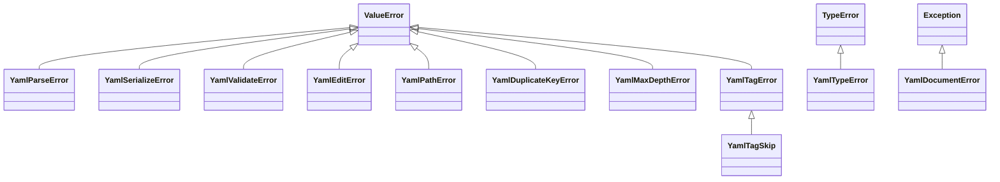

## Exceptions

pyrs-yaml defines custom exception classes for error handling.



### YamlParseError

Raised when YAML parsing fails.

```python
class YamlParseError(ValueError):
    """YAML parsing error (inherits from ValueError)."""
```

**Inherits from:** `ValueError`

**Example:**

```python title="Try/except example"
try:
    doc = pyrs_yaml.parse("invalid: yaml: [")
except pyrs_yaml.YamlParseError as e:
    print(e)
    # "YAML parse error: mapping values are not allowed in this context at char 13 line 1 column 14"
```

**Can be caught as:**

```python
except ValueError as e:  # Also works
```

### YamlSerializeError

Raised when YAML serialization fails.

```python
class YamlSerializeError(ValueError):
    """YAML serialization error (inherits from ValueError)."""
```

**Inherits from:** `ValueError`

A Python object the writer does not know is refused one layer earlier, as
[`YamlTypeError`](#yamltypeerror): `pyrs_yaml.safe_dump(object())` answers
`Unsupported Python type for YAML conversion`. This class is the target format running out of
room for a value that converted fine — the message carries a stable reason key for it.

```python title="Try/except example"
doc = pyrs_yaml.parse("a: .inf")
try:
    text = doc.to_json()
except pyrs_yaml.YamlSerializeError as e:
    print(e)
    # "json-cannot-represent-non-finite"
```

### YamlTypeError

Raised when a type conversion error occurs.

```python
class YamlTypeError(TypeError):
    """YAML type conversion error (inherits from TypeError)."""
```

**Inherits from:** `TypeError`

**Example:**

```python title="Try/except example"
try:
    pyrs_yaml.parse(123)  # Expected str or bytes
except pyrs_yaml.YamlTypeError as e:
    print(f"Type error: {e}")
```

### YamlValidateError

Raised when JSON Schema validation fails via `YamlDocument.validate()`.

```python
class YamlValidateError(ValueError):
    """JSON Schema validation error (inherits from ValueError)."""
```

**Inherits from:** `ValueError`

**Example:**

```python
doc = pyrs_yaml.parse("name: Alice")
schema = {"type": "object", "required": ["name", "email"]}
try:
    doc.validate(schema)
except pyrs_yaml.YamlValidateError as e:
    print(f"Validation error: {e}")
    # Output: "Validation error: 'email' is a required property"
```

A schema that is neither a `str` nor a mapping still lands in this class, carrying the engine's
own refusal text: `doc.validate(3)` answers
`YamlValidateError: TypeError: argument of type 'int' is not iterable`.

!!! warning "Delegation boundary"
    Evaluation is delegated to the Python `jsonschema` package, and **nothing this project
    publishes installs it**: `[project.dependencies]` is `typing-extensions` alone and the three
    extras are `cli`, `pydantic` and `settings`. Two doors therefore answer outside the
    `Yaml*` classes, both measured on this build:

    - `doc.validate({"type": "object"})` answers a bare `ModuleNotFoundError` — not a
      `YamlValidateError`. Its text depends on how the module is missing: with the name genuinely
      absent it is `No module named 'jsonschema'`, and halted the way `tests/test_validate.py`
      reproduces the absent wheel (`sys.modules["jsonschema"] = None`) it is
      `import of jsonschema halted; None in sys.modules`.
    - the `str` schema door runs `json.loads` **before** the evaluator, so a YAML-spelled schema
      text answers `json.decoder.JSONDecodeError: Expecting value: line 1 column 1 (char 0)`
      whether or not `jsonschema` is installed. A schema text that is valid JSON still reaches
      the evaluator, and there the missing module is the `ModuleNotFoundError` above.

    Both escape the CLI's `except YamlValidateError` arm in `pyrs-yaml validate`, which is why
    that command prints a traceback instead of its usual `error: …` line — measured through the
    console script for the YAML-spelled schema (stderr traceback, empty stdout, exit `1`) — see
    [Validation](../guides/cli.md#cmd-validate).

    Neither is a defect this page fixes. Both are registered boundaries in
    `.ci/known-residuals.json` — `api:validate-evaluator-is-not-installed-by-anything-we-ship` and
    `api:validate-schema-text-is-json-only` — each carrying its reproduction test and the exit
    criterion that would close it.

### YamlEditError

Raised when an in-place edit cannot be applied. Measured on the current build, the refusals that
reach this class are: a path that does not resolve, navigation into a scalar or into a container
of the wrong shape, an index out of range, an edit made **through** an alias, an anchor still
referenced by an alias, a rename of the root or of a complex key or onto an existing key, a
duplicate delete target, and an unknown `on_duplicate` value.

Three things this class does **not** cover, all measured:

- An unsupported Python value is a `YamlTypeError`, not an edit error — `doc.set("$.a", {1, 2})`
  and `doc.set("$.a", object())` answer
  `YamlTypeError: Unsupported Python type for YAML conversion`. A `tuple` and `bytes` are
  accepted (`bytes` becomes `!!binary`).
- A negative index is not a refusal — `$.items[-1]` addresses the last element. Only an index
  outside the sequence is, and it names itself `index-out-of-range-edit`.
- Setting the **alias's own path** is not a refusal either:
  `pyrs_yaml.parse("base: &x 1\nuse: *x\n").set("$.use", 2)` succeeds and re-emits
  `base: &x 1\nuse: 2\n`, leaving `&x` unreferenced. The other verbs on that pair are just as
  quiet — measured on the same document, `delete("$.use")` leaves `base: &x 1\n` and
  `rename("$.use", "used")` leaves `base: &x 1\nused: *x\n`, while on `prod: *d` a
  `Node.rename("prod2")` renames the key to `prod2: *d`. Editing *through* the alias is what raises.

```python
class YamlEditError(ValueError):
    """In-place edit error (inherits from ValueError)."""
```

**Inherits from:** `ValueError`

**Example:**

```python title="Try/except example"
doc = pyrs_yaml.parse("a:\n  b: 1")

try:
    doc.set("$.a.b.c", 2)  # Navigates into a scalar
except pyrs_yaml.YamlEditError as e:
    print(e)
    # "edit failed: create-needs-mapping"
```

Every message is listed with its trigger in [Edit reason tokens](#edit-reason-tokens).

### YamlPathError

Raised when a JSONPath-style path is malformed or not editable: paths not starting with `$`, wildcard (`[*]`) or deep-scan (`..`) segments used in edit operations.

```python
class YamlPathError(ValueError):
    """YAML path error (inherits from ValueError)."""
```

**Inherits from:** `ValueError`

**Example:**

```python
doc = pyrs_yaml.parse("items: [1, 2]")

try:
    doc.set("$.items[*]", 3)  # Wildcards are not editable
except pyrs_yaml.YamlPathError as e:
    print(e)
    # "wildcard/deep-scan paths are not editable"
```

The three messages this class answers with are all measured, and none of them carries the
`edit failed:` prefix:

| Path handed to an edit | Measured `str(exc)` |
|------------------------|---------------------|
| `"items[0]"`, `""` (no leading `$`) | `Path must start with $` |
| `"$.items[*]"`, `"$..b"` | `wildcard/deep-scan paths are not editable` |
| `"$.items[abc]"` | `invalid index in path: $.items[abc]` |

`"$."` is not one of them: the trailing dot is dropped and the path addresses the root, so
`doc.set("$.", 2)` replaces the whole document with the scalar `2`.

### YamlDocumentError

Raised when a `Node` becomes stale — the document was modified (or released) after the node was created.

```python
class YamlDocumentError(Exception):
    """Raised when a Node's parent YamlDocument is stale."""
```

**Inherits from:** `Exception`

**Example:**

```python
node = doc.node().find("$.a")
doc.set("$.b", 2)  # Bumps the document revision
node.set_value(99)  # RuntimeWarning + YamlDocumentError
```

The two refusals carry their own sentences, both measured, and both preceded by a
`RuntimeWarning` on stderr:

| How the node died | Measured `str(exc)` |
|-------------------|---------------------|
| The document was edited after the node was created | `document has been modified; re-find the node` |
| `node.release()` was called | `parent document has been released` |

`is_valid()` does not report either state — a node whose own delete bumped the revision still
answers `True`; only `release()` clears it.

### YamlDuplicateKeyError

Raised when a duplicate mapping key is detected in the input.

```python
class YamlDuplicateKeyError(ValueError):
    """Duplicate mapping key error (inherits from ValueError)."""
```

**Inherits from:** `ValueError`

**Example:**

```python title="Try/except example"
try:
    pyrs_yaml.parse("key: 1\nkey: 2")
except pyrs_yaml.YamlDuplicateKeyError as e:
    print(f"Duplicate key: {e}")
```

### YamlMaxDepthError

Raised when the YAML document exceeds the maximum nesting depth.

```python
class YamlMaxDepthError(ValueError):
    """Maximum nesting depth exceeded (inherits from ValueError)."""
```

**Inherits from:** `ValueError`

**Example:**

```python title="Try/except example"
try:
    pyrs_yaml.parse("a:\n  b:\n    c:\n      ...", max_depth=2)
except pyrs_yaml.YamlMaxDepthError as e:
    print(f"Max depth exceeded: {e}")
```

### YamlTagError

Raised when a tag handler is registered with an invalid name or signature.

```python
class YamlTagError(ValueError):
    """Tag handler error (inherits from ValueError)."""
```

**Inherits from:** `ValueError`

### YamlTagSkip

Sentinel exception raised by a tag handler to pass the node to the next handler in the chain. When no handler accepts it, the node keeps its value from the source. This is not a real error — it is an intentional control-flow signal.

!!! info "Control-flow sentinel"
    `YamlTagSkip` is not a real error. It is a signal for tag handlers
    to delegate to the next handler in the chain. Raising it from a
    handler passes control to the next handler (or falls through to
    the default).

```python
class YamlTagSkip(YamlTagError):
    """Tag handler skip sentinel (inherits from YamlTagError)."""
```

**Inherits from:** `YamlTagError`

**Example:**

```python title="Skip handler example"
@pyrs_yaml.register_tag("!skip_me")
def handler(node):
    raise pyrs_yaml.YamlTagSkip
```

### Edit reason tokens { #edit-reason-tokens }

A `YamlEditError` names *why* the edit was refused with a stable lowercase token. There is no
`.reason` attribute to read: the exception classes expose only `args`, `add_note()` and
`with_traceback()`, and the token sits inside the message — measured on
`pyrs_yaml.parse("base: &x 1\nuse: *x\n").delete("$.base")`, whose `exc.args` is the single string
`("edit failed: anchor-is-referenced",)`. So a caller switches on the token as a substring of
`str(exc)`, and it may match on the token alone: the `edit failed:` prefix localizes with
`set_language()` while the token does not (see [i18n Support](#i18n-support)).

Each row below was run against the current build. The YAML inputs are written with `\n` because
that is the text handed to `parse()`.

| Reason | The calls that answer it | Measured `str(exc)` |
|--------|--------------------------|---------------------|
| `anchor-is-referenced` | `delete("$.base")` on `pyrs_yaml.parse("base: &x 1\nuse: *x\n")`; also `set_anchor()` and `remove_anchor()` on that node, `delete()` of `$.defaults` while `prod: *defaults` survives, and `move()` onto it | `edit failed: anchor-is-referenced` |
| `cannot-edit-alias` | `set("$.prod.timeout", 99)` on `parse("defaults: &d\n  timeout: 30\nprod: *d\n")`; also `insert()`/`append()` on a path whose parent is an alias, `delete()`/`rename()` of a key inside one, `Node.set_value()` and `Node.delete()` on a node reached through the alias, and every metadata verb called on the alias node itself — `set_comment()`, `remove_comment()`, `set_leading_comment()`, `remove_leading_comment()`, `set_tag()`, `remove_tag()`, `set_anchor()`, `remove_anchor()`, `set_flow_style()`, `set_scalar_style()`, `set_chomping()` and `sort_keys()` | `edit failed: cannot-edit-alias` |
| `create-needs-mapping` | `set("$.a.b.c", 2)` on `parse("a:\n  b: 1\n")` — the step lands on a scalar; also a container-shaped segment on the wrong container (`parse("items: [1, 2]\n").set("$.items.name", 2)`), an index into a mapping (`parse("a: 1\n").set("$.a[0]", 2)`), and any keyed write on a scalar root (`parse("just a scalar\n")["b"] = 2`) | `edit failed: create-needs-mapping` |
| `cannot-descend-into-scalar` | `set("$.a.b.c", 2, create_missing=True)` on `parse("a: 1\n")`; also `parse("a: 1\n").insert("$.a.b", 0, 1)`, and on a scalar root `parse("just a scalar\n").set("$.a.b", 2, create_missing=True)` | `edit failed: cannot-descend-into-scalar:b` — the refused segment follows the colon (`…:a` for the scalar root) |
| `missing-path` | `delete("$.zz")` on `parse("a: 1\n")`; also `rename()` and `sort_keys()` on a path that does not resolve, `del doc["zz"]`, and a metadata setter on the `Node(invalid)` that `find()` returns for a miss | `edit failed: missing-path` |
| `missing-path:<key>` | `set("$.b.c.d", 2)` on `parse("a: 1\n")` — a missing **intermediate** key; also `parse("items: 1\n").insert("$.nope", 0, "z")` and `parse("src:\n  x: 1\n").node().move("$.deep.leaves")` | `edit failed: missing-path:b` — the navigation layer names the first key that missed (`missing-path:nope`, `missing-path:deep`) |
| `not-a-sequence` | `insert("$.a", 0, "z")` and `append("$.a", "z")` on `parse("a: 1\n")` | `edit failed: not-a-sequence` |
| `index-out-of-range-edit` | `insert("$.items", 42, "z")` on `parse("items:\n  - a\n")`; also `insert()` with `-99`, `delete("$.items[9]")`, and `delete("$[5]")` on a two-item root sequence | `edit failed: index-out-of-range-edit` |
| `index-out-of-range-edit:<index>` | `set("$.items[7]", 99)` on `parse("items: [1, 2, 3]\n")`; also the negative spelling `set("$.items[-99]", 99)`, and `parse("items: []\n").set("$.items[2]", 1, create_missing=True)` | `edit failed: index-out-of-range-edit:7` — the refused index follows the colon (`…:-99`, `…:2`) |
| `cannot-rename-root` | `rename("$", "b")` on `parse("a: 1\n")`; also `parse("a: 1\n").node().rename("b")` | `edit failed: cannot-rename-root` |
| `cannot-rename-complex-key` | `rename("$[0]", "b")` on `parse("? [1, 2]\n: value\n")`; also a mapping-valued complex key (`? {a: 1}`), and any sequence element — which has no key to rename — via `parse("- a\n- b\n").rename("$[0]", "x")` or `Node.children[1].rename("x")` | `edit failed: cannot-rename-complex-key` |
| `rename-key-exists` | `rename("$.a", "b")` on `parse("a: 1\nb: 2\n")` | `edit failed: rename-key-exists` |
| `duplicate-key-target` | `delete("$.a", on_duplicate="error")` on `parse("a: 1\n!!str a: 2\n")`; also `node.delete(on_duplicate="error")` on the same document | `edit failed: duplicate-key-target` |
| `unknown on_duplicate` | `delete("$.a", on_duplicate="both")` on `parse("a: 1\n")` | `edit failed: unknown on_duplicate "both"; expected one, all or error` |
| `edit-error` | `parse("a: 1\n").delete("$")`, `parse("a: 1\n").node().delete()`, and `parse("src:\n  x: 1\n").node().move("$.src")` — each asks the engine to delete a path whose segment list is empty, i.e. the root itself | `edit failed: edit-error` |
| *(no token)* | `parse("? [1, 2]\n: value\n").node().children[0].rename("b")` — a complex key cannot become a path segment | `ValueError: segment must be str or int` |
| *(style refusal)* | `parse("a: 1\n").node().find("$.a").set_scalar_style("squiggle")` | `unknown scalar style 'squiggle': expected one of plain, single_quoted, double_quoted, literal, folded` |
| *(chomping refusal)* | `parse("a: |\n  text\n").node().find("$.a").set_chomping("squiggle")` | `unknown chomping 'squiggle': expected one of strip, clip, keep` |

The last three rows are `YamlEditError` as well, but they are written where they are raised rather
than run through the `edit failed:` template, so they carry no prefix. The bare `edit-error` token
has two producers behind it — `editing/plan.rs` returns the string when a delete's segment list is
empty, and `EditError::Generic` displays the same token from the one place that constructs it,
`editing/region.rs` taking the last segment of a path — and the three root-shaped calls above are
what reach it in practice. Renaming a key to itself is
not a refusal at all: `rename("$.a", "a")` succeeds and leaves `a: 1` in place, and
`rename("$.a", "a")` on a document holding both `a` and `!!str a` succeeds too — the duplicate
policy belongs to `delete()` only.

#### Reason tokens no call answers

Enumerated from the engine's error declarations (`crates/pyrs-ast/src/error.rs`) and the editing
layer (`crates/pyrs-yaml-core/src/editing/plan.rs`), these spellings exist in the Rust source and
were **not** reachable from any Python call:

- `internal-error: …` — `EditError::Internal` has no construction site anywhere in the tree, and
  `SerializeError::Internal` has exactly one (the `is_compact_item on non-mapping` invariant in
  `crates/pyrs-yaml-core/src/serializer.rs`), which no Python call reached. A message starting with
  it would be a bug report, not a refusal to handle.
- `wildcard-or-deep-scan`, `invalid-index:{0}`, `invalid-path` — the `PathError` enum has no
  construction site at all. What a Python caller sees for those cases is the `YamlPathError`
  text in the table above (`Path must start with $` and its two siblings), produced in
  `python/pyrs_yaml/editing.py` before the path ever reaches Rust.
- `duplicate key: <key>` and `max depth exceeded (max=<n>)` are the Rust `Display` spellings;
  the Python classes for them answer `duplicate key: key` (same text) and
  `Maximum YAML depth exceeded (max=2)`.

### Error Message Format

Each format below is the text a probe against the current build actually printed. `<…>` marks the
part that varies.

| Refusal | Format |
|---------|--------|
| Parse error | `"YAML parse error: <parser message> at char <N> line <L> column <C>"` |
| Invalid UTF-8 | `"Invalid UTF-8: <detail>"` |
| Duplicate key | `"duplicate key: <key>"` |
| Maximum depth | `"Maximum YAML depth exceeded (max=<n>)"` |
| Second document in a one-document route | `"multi-document-input: this input carries a second document at line <L>, column <C> and this route reads one. …"` |
| Unknown reader policy | `'unknown duplicate_keys "<value>"; expected as_is, error, last_wins or first_wins'` |
| Schema validation failure | `"<jsonschema message>"` — e.g. `'email' is a required property` |
| Edit failure | `"edit failed: <reason token>"` — see [Edit reason tokens](#edit-reason-tokens) |
| Style / chomping argument | unprefixed sentence: `"unknown scalar style '<value>': expected one of plain, single_quoted, double_quoted, literal, folded"`, `"unknown chomping '<value>': expected one of strip, clip, keep"` |
| Duplicate-policy argument | `"edit failed: unknown on_duplicate \"<value>\"; expected one, all or error"` |
| Writer has no room for the value | the reason key alone: `"json-cannot-represent-non-finite"`, `"json-cannot-represent-alias"`, `"toml-unsupported-node"` (an alias), `"toml-requires-table-root"` (a sequence root), `"toml-keys-must-be-scalars"` (a complex key), `"toml-cannot-represent-null"`, `'unknown note_placement "<value>"; expected note_first or header_first'` |
| Unsupported Python value | `"Unsupported Python type for YAML conversion"` — the same text for an ndarray whose dtype the route cannot decode (`datetime64`, a structured dtype, `object`) |
| Not a `str` or `bytes` | `"Expected str or bytes"` |
| Wrong key kind for the container | `"Index must be an integer"` |
| Malformed path | no prefix at all: `"Path must start with $"`, `"wildcard/deep-scan paths are not editable"`, `"invalid index in path: <path>"` |
| Mapping key missing | `KeyError` whose text is `"Key '<key>' not found"` |
| Sequence index out of range | `IndexError` whose text is `"Index <index> out of range (len=<len>)"` |
| Stale node | `"document has been modified; re-find the node"`, or `"parent document has been released"` |

Three of those rows are not `Yaml*` classes, and two are not localized either:

- A file that cannot be read answers a plain `OSError: Failed to read file: <OS message> (os error
  <N>)`. The `<OS message>` fragment comes from the host, so it arrives in the host's own language
  (this build printed the Chinese OS text for a missing file). There is no `"File read error: …"`
  template in the answer.
- `KeyError` and `IndexError` are the builtins with their own quoting, so `str(exc)` shows
  `"Key 'zz' not found"` with the outer quotes included. Their text does follow `set_language()`.
- Parse errors never localize. `YAML parse error: …` is the engine's own wording, printed in English
  under `zh-CN`, `ja-JP` and `ko-KR` alike (measured — see [i18n Support](#i18n-support)).

### i18n Support

Four locales are installed — `en`, `zh-CN`, `ja-JP`, `ko-KR` — and `pyrs_yaml.detect_language()`
reports the one in effect. A value outside those four is refused by the builtin
`ValueError: Unsupported language: 'xx-XX'. Supported: ["en", "zh-CN", "ja-JP", "ko-KR"]`.

Which half of a message moves depends on where it was written. Measured across all four locales:

```python title="Localized error messages"
import pyrs_yaml

pyrs_yaml.set_language("zh-CN")
doc = pyrs_yaml.parse("base: &x 1\nuse: *x\n")

try:
    doc.delete("$.base")
except pyrs_yaml.YamlEditError as e:
    print(e)
    # "编辑失败：anchor-is-referenced" — prefix translated, reason token untouched

try:
    pyrs_yaml.parse("a: b: c")
except pyrs_yaml.YamlParseError as e:
    print(e)
    # "YAML parse error: mapping values are not allowed in this context at char 4 line 1 column 5"
    # — the parser's own wording, and it stays English in every locale
```

| Part of a message | Follows `set_language()`? |
|-------------------|---------------------------|
| The `Yaml*` templates: `edit failed:`, `Invalid UTF-8:`, `Unsupported Python type for YAML conversion`, `Key '<key>' not found`, `Index <n> out of range (len=<n>)` | Yes — `编辑失败：`, `編集に失敗しました：`, `편집 실패: ` were measured for the edit prefix |
| The edit reason token after that prefix (`anchor-is-referenced`, `missing-path:b`, `unknown on_duplicate …`) | No — English in all four locales, which is what makes it the thing to match on |
| Parser text (`YAML parse error: …`, `multi-document-input: …`) | No — English everywhere, measured under `zh-CN`, `ja-JP` and `ko-KR` |

`set_language("en")` restores the English templates, and the catalog is process-wide: it is shared
by every document, not stored per document.

### Best Practices

```python title="Safe load helper"
import pyrs_yaml


def load_yaml(path):
    try:
        doc = pyrs_yaml.parse_file(path)
        return doc.to_dict()
    except pyrs_yaml.YamlParseError as e:
        print(f"Failed to parse {path}: {e}")
        return None
    except OSError as e:
        print(f"Failed to read {path}: {e}")
        return None
```

## Generated API reference

Rendered by `mkdocstrings` from the generated type stub, so the base class shown for each error is the one the bindings actually declare.

::: pyrs_yaml.YamlParseError
::: pyrs_yaml.YamlSerializeError
::: pyrs_yaml.YamlTypeError
::: pyrs_yaml.YamlValidateError
::: pyrs_yaml.YamlEditError
::: pyrs_yaml.YamlPathError
::: pyrs_yaml.YamlMaxDepthError
::: pyrs_yaml.YamlDuplicateKeyError
::: pyrs_yaml.YamlTagError
::: pyrs_yaml.YamlTagSkip
