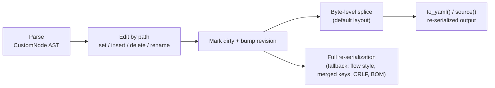

## In-Place Editing

pyrs-yaml lets you **edit a parsed document in place** while preserving all formatting metadata (comments, anchors, tags, scalar styles, flow/block style) — no manual string surgery, no fidelity loss.

### Overview

Edits are expressed as **JSONPath-style paths** into the document tree:

```python title="Edit by path"
import pyrs_yaml

doc = pyrs_yaml.parse("""
db:
  host: localhost
  port: 5432
""")

doc.set("$.db.host", "db.example.com")  # set by path
doc.set("$.db.port", 5433)
print(doc.to_yaml())
# db:
#   host: db.example.com
#   port: 5433
```

All edit methods are **atomic**: on failure nothing changes, including the document revision. On success the document is marked dirty, and the next `source()` / `to_yaml()` / `to_yaml_with_options()` / `reparse()` call re-serializes from the updated tree.

#### Edit Pipeline



### Path Syntax

Paths start with `$` followed by dot-separated keys (mapping) or `[N]` indices (sequence):

| Path | Meaning |
|------|---------|
| `$.host` | Key `host` of the root mapping |
| `$.a.b.c` | Nested keys |
| `$.items[0]` | First element of sequence `items` |
| `$` | The root node itself |

- **Negative indices** (`[-1]`, `[-2]`, ...) are **supported** — they count from the end of a sequence (Python semantics: `-1` is the last element). An out-of-range negative index raises `YamlEditError`, naming the index it could not place: `parse("items: [1, 2, 3]\n").set("$.items[-99]", 99)` answers `edit failed: index-out-of-range-edit:-99`
- Keys are matched **by value** (metadata-insensitive), so a quoted key `"host"` matches the plain key `host`

Editing paths must target exactly one node — **wildcards** (`[*]`) and **deep-scan** (`..`) raise `YamlPathError`. (Query-only `find()` does support them; see [Querying with `find()`](#querying-with-find).)

**Raises** `YamlPathError` for malformed paths, and `YamlEditError` when a path step cannot be applied — measured as `edit failed: cannot-edit-alias` for a step through an alias and `edit failed: create-needs-mapping` for a step into a scalar. The reason token is the stable part; see [Edit reason tokens](../api/exceptions.md#edit-reason-tokens).

### Setting Values

#### `set()` — replace by path

```python title="set() signature"
set(path: str, value: Any) -> None
```

```python title="set() examples"
doc = pyrs_yaml.parse("a:\n  b: 1\nitems: [1, 2, 3]")

doc.set("$.a.b", 42)  # scalar → scalar, metadata preserved
doc.set("$.items[1]", "two")  # sequence index
doc.set("$.a.c", True)  # add a new key to a mapping (last position)
doc.set("$", {"x": 1})  # replace the entire root
```

Setting a path on an **empty document** (parsed from `""`) auto-creates a mapping root:

```python title="Set on empty document"
doc = pyrs_yaml.parse("")
doc.set("$.a", 1)  # doc now holds {a: 1}
```

Value conversion rules:

| Python value | YAML node |
|--------------|-----------|
| :material-format-text: `str`, :material-numeric: `int`, :material-decimal: `float`, :material-toggle-switch: `bool`, :material-null: `None` | New scalar (value is *not* re-parsed) |
| :material-language-python: `dict` | New mapping (plain style) |
| :material-format-list-numbered: `list` | New sequence (plain style) |
| :material-format-list-numbered: `tuple` | New sequence (plain style) — the same node a `list` makes |
| :material-format-list-numbered: `bytes` | New scalar tagged `!!binary` — `doc.set("$.a", b"hi")` emits `a: !!binary aGk=` |

A Python type outside that table is refused by the writer, not by the edit path: measured on `set("$.a", {1, 2})` and `set("$.a", object())`, both answer `YamlTypeError: Unsupported Python type for YAML conversion`.

When replacing an existing scalar, the target's metadata (inline comment, anchor, tag, quoting style) is **preserved** — unless the new value is a mapping/sequence, which adopts the new node's own formatting.

#### `__setitem__` — root sugar

```python title="__setitem__ root sugar"
doc["b"] = 2  # equivalent to doc.set("$.b", 2)
```

#### `Node.set_value()` — edit through a Node

```python title="set_value()"
node = doc.node().find("$.a.b")  # see "Working with Nodes"
node.set_value(42)
```

### Inserting and Appending

Both operate on **sequences** only; the path must resolve to a sequence node.

#### `insert()` — insert at an index

```python title="insert() signature"
insert(path: str, index: int, value: Any) -> None
```

`index` may be up to the current length (inserting at `len` appends); anything larger raises `YamlEditError: edit failed: index-out-of-range-edit`, as does an index below `-len` — `parse("items:\n  - a\n").insert("$.items", -99, "z")`. Negative indexes are supported and count from the end (`-1` inserts before the last element, `-len` inserts at the front).

```python title="insert() examples"
doc = pyrs_yaml.parse("items:\n  - a\n  - c")

doc.insert("$.items", 1, "b")  # items: [a, b, c]
doc.insert("$.items", 0, "first")
doc.insert("$.items", 3, "last")  # index == len appends
doc.insert("$.items", -1, "before-last")  # items: [a, before-last, c]
```

#### `append()` — add at the end

```python title="append() signature"
append(path: str, value: Any) -> None
```

```python title="append() example"
doc.append("$.items", "d")
```

#### `Node.append()` / `Node.insert()`

The same operations are available on `Node` objects:

```python title="Node append/insert"
node = doc.node().find("$.items")
node.append("d")
node.insert(1, "x")
```

### Deleting

#### `delete()` — remove by path

```python title="delete() signature"
delete(path: str, on_duplicate: str = "one") -> None
```

```python title="delete() example"
doc = pyrs_yaml.parse("a: 1\nb: 2\nc: 3")
doc.delete("$.b")
print(doc.to_yaml())  # a: 1\nc: 3\n — order preserved
```

Mapping order is always preserved; sequence deletion closes the gap.

A document can hold two keys that spell one name and are told apart only by a tag or an anchor the
reader keeps, so removing one leaves the other answering that name once the emission is read back.
`delete()` asks the caller which answer it wants through `on_duplicate`:

- `one` (the default) deletes the pair the path resolves to — the behaviour every existing caller has.
- `all` deletes every pair that key could answer with, so the name is gone from the emission too.
- `error` refuses with `duplicate-key-target` while more than one pair remains, and leaves the
  document untouched.

An unrecognised value is itself a named refusal rather than a silent fall back to the default.
`del doc[key]` and `Node.delete()` keep the default.

#### `__delitem__` — root sugar

```python title="__delitem__ root sugar"
del doc["b"]  # equivalent to doc.delete("$.b")
```

#### `Node.delete()`

```python title="Node.delete()"
node = doc.node().find("$.b")
node.delete()
```

### Renaming

#### `rename()` — rename a mapping key in place

```python title="rename() signature"
rename(path: str, new_key: str) -> None
```

The path must point at a **mapping key** (the value lives under it and keeps its metadata):

```python title="rename() example"
doc = pyrs_yaml.parse("old: value  # keep me\nnext: 1")
doc.rename("$.old", "new")
print(doc.to_yaml())  # new: value  # keep me\nnext: 1
```

- **Position is preserved** — the renamed key stays in place
- **Metadata is preserved** — the key's inline comment, style, and anchor travel with the rename
- Renaming the root, a complex (non-scalar) key, or onto an **existing key** raises `YamlEditError` with `edit failed: cannot-rename-root`, `cannot-rename-complex-key` or `rename-key-exists` (renaming a key to itself is a no-op)
- A **sequence element** is not a mapping key either way: `parse("- a\n- b\n").rename("$[0]", "x")` and `Node.children[1].rename("x")` both answer `edit failed: cannot-rename-complex-key`
- On a document whose key is a complex node, addressing it through a `Node` is refused one layer earlier — `parse("? [1, 2]\n: value\n").node().children[0].rename("b")` answers `YamlEditError: ValueError: segment must be str or int`, because the complex key cannot become a path segment

#### `Node.rename()`

```python title="Node.rename()"
node = doc.node().find("$.old")
node.rename("new")
```

### Tags and Metadata

Comments, anchors, and tags survive round-trip by default. Through a `Node` you can read and edit them as well — editing is re-serialized in place, preserving everything else.

#### Reading metadata

```python title="Reading node metadata"
doc = pyrs_yaml.parse("key: !!str value  # note")
node = doc.node().find("$.key")
node.comment  # "note"
node.anchor  # None
node.tag  # "!!str"
```

- `comment` — inline or standalone comment text (without the `#` prefix), or `None`
- `anchor` — anchor name, or `None`
- `tag` — YAML tag string, or `None`

#### `Node.set_comment()` / `Node.remove_comment()`

```python title="Set/remove comment"
node.set_comment("new note")  # standalone: own line above
node.set_comment("inline", standalone=False)  # inline after the node
node.remove_comment()
```

#### `Node.set_anchor()` / `Node.remove_anchor()`

```python title="Set/remove anchor"
node.set_anchor("cfg")
node.remove_anchor()
```

The anchor can then be referenced by aliases elsewhere in the document.

#### `Node.set_tag()` / `Node.remove_tag()`

```python title="Set/remove tag"
node.set_tag("!custom")  # local tag
node.set_tag("!!int")  # primary tag
node.set_tag("!<tag:yaml.org,2002:str>")  # verbatim tag
node.remove_tag()
```

- Editing metadata on an **alias** node (`*ref`) raises `YamlEditError: edit failed: cannot-edit-alias` — measured for `set_comment()`, `set_tag()` and `set_anchor()`, and for `remove_anchor()` on the referenced source node
- Editing metadata on a **missing path** raises `YamlEditError: edit failed: missing-path` — including on the `Node(invalid)` object that `find()` returns for a path the document does not hold
- Setting or removing an **anchor that an alias still references** is refused: `set_anchor()`/`remove_anchor()` on the anchored node answer `YamlEditError: edit failed: anchor-is-referenced`. With no alias left, the same call succeeds — `parse("base: &x 1\n")` then `set_anchor("renamed")` emits `base: &renamed 1`
- After an edit the node is **stale** — re-find it with `doc.node().find(path)` before the next access

### Working with Nodes

You can obtain a node reference and edit it through either the document path API or the Node API:

=== "Document path API"

    ```python
    doc.set("$.db.host", "other")  # set by path
    doc.set("$.db.port", 5433)
    print(doc.find("$.db.host").value)  # "other"
    ```

=== "Node API"

    ```python
    node = doc.node()  # root node
    node = doc.node().find("$.db.host")  # navigate by path
    print(node.value)  # "localhost"
    node.set_value("other")  # edit through the node
    print(node.root_type)  # "scalar" | "mapping" | "sequence" | "null"
    ```

Nodes expose a tree API: `node.parent`, `node.children`, `node.walk()` (depth-first iterator), `node.filter(predicate)`, and `node.to_yaml()`.

#### Walking the AST (`doc.walk()` / `doc.scalars()`)

`doc.walk()` and `doc.scalars()` are **Rust-backed** traversal methods that yield `Node` objects without converting the entire AST to Python dicts. Unlike `Node.walk()` (which calls `to_dict()` under the hood), these methods traverse the AST directly:

```python title="Rust-backed traversal"
doc = pyrs_yaml.parse("a:\n  b: 1\n  c: 2\n")

# Walk all nodes (depth-first, pre-order)
for node in doc.walk():
    print(node._path, node.root_type)
# ()       mapping
# ('a',)   mapping
# ('a', 'b') scalar
# ('a', 'c') scalar

# Walk only scalar/null nodes
for node in doc.scalars():
    print(node._path, node.value)
# ('a', 'b') 1
# ('a', 'c') 2
```

This is significantly faster than the Python-only `Node.walk()` for large documents, especially when you only need path information or scalar values.

#### Create Missing Keys (`create_missing=True`)

By default, `set()` raises `YamlEditError` when an intermediate key in the path doesn't exist. With `create_missing=True`, missing intermediate mapping keys are automatically created:

```python title="create_missing example"
doc = pyrs_yaml.parse("a: 1\n")

# Without create_missing — raises
doc.set("$.b.c.d", 2)  # YamlEditError: missing path

# With create_missing — creates b → c → d
doc.set("$.b.c.d", 2, create_missing=True)
print(doc.to_yaml())
# a: 1
# b:
#   c:
#     d: 2
```

Rules:

- Missing **mapping keys** are created as nested mappings
- Missing **index segments** still raise (can't auto-create a sequence element) — measured: `parse("items: []\n").set("$.items[2]", 1, create_missing=True)` answers `edit failed: index-out-of-range-edit:2`
- A **scalar** intermediate along the path still raises (can't descend into a scalar) — measured: `parse("a: 1\n").set("$.a.b.c", 2, create_missing=True)` answers `edit failed: cannot-descend-into-scalar:b`, naming the segment it refused to walk through. Without `create_missing` the same shape answers `edit failed: create-needs-mapping` instead
- The created chain is eligible for in-place splice editing

#### Querying with `find()`

`find()` is **read-oriented** and supports wildcards and deep scans — it returns a list when the path selects multiple nodes:

```python title="find() wildcards"
doc.node().find("$.items[*]")  # all items of a sequence (list of Nodes)
doc.node().find("$..timeout")  # deep search for any key named "timeout"
```

Wildcard/deep-scan results are **not directly editable** via `set()` — use
`doc.set_many()` to apply values to wildcard paths in one call (below).

### Bulk and Structural Edits

#### `doc.set_many()` — apply multiple values at once

Set multiple paths in a single splice burst. Paths may include wildcards
(`[*]`) and deep scans (`..`) — every matching node is set:

```python title="set_many()"
doc = pyrs_yaml.parse("items:\n  - pass: true\n  - pass: true\n")
doc.set_many(
    {
        "$.items[*].pass": False,  # wildcard: every item
        "$.name": "config",  # plain path
    }
)
```

#### `doc.sort_keys()` — order mapping keys

Sort the keys of a mapping (default: root) in place:

```python title="sort_keys() example"
doc = pyrs_yaml.parse("z: 1\na: 2\nm: 3\n")
doc.sort_keys()  # sorts the root mapping
print(doc.to_yaml())  # a: 2\nm: 3\nz: 1
```

#### `Node.move(new_path)` — relocate a subtree

Move a subtree to a new path in the same document (copies then removes the
source):

```python title="Node.move() example"
doc = pyrs_yaml.parse("src:\n  x: 1\ndst: {}\n")
doc.node().find("$.src").move("$.dst")
print(doc.to_yaml())  # dst:\n  x: 1
```

Measured edges of that contract:

- The destination **need not exist** as long as its parent does: `parse("src:\n  x: 1\n").node().find("$.src").move("$.nope")` leaves `nope:\n  x: 1`. A destination with a missing **intermediate** is refused — `move("$.deep.leaves")` answers `edit failed: missing-path:deep`
- Replacing an existing destination's value works whatever that value is, including a scalar: `dst: 2` becomes `dst:\n  x: 1`
- Moving a subtree **onto its own path** is not refused and empties the document — `find("$.src").move("$.src")` on `src:\n  x: 1` emits the empty mapping `{}`
- Moving the **root** is refused: `pyrs_yaml.parse("src:\n  x: 1\n").node().move("$.src")` answers `edit failed: edit-error`
- Moving onto a path whose value still has a referencing alias answers `edit failed: anchor-is-referenced`

#### `Node.path` / `Node.find_first()` / `Node.value_eq()`

```python title="Node introspection"
node = doc.node().find("$.a.b")
node.path  # ('a', 'b') — the path segments
doc.node().find_first("$.items[*]")  # first wildcard match or None
node.value_eq(other_node)  # compare resolved values (not reference identity)
```

### Aliases and Merge Keys

!!! warning "Editing through an alias"
    Navigating through an alias node (e.g. setting a key inside `*defaults`)
    raises `YamlEditError: edit failed: cannot-edit-alias` — the referenced node lives
    elsewhere and cannot be edited through the alias reference. Measured on every edit
    route: `set()`, `insert()`, `append()`, `delete()`, `rename()` and the metadata
    setters all answer the same token when a path step lands on an alias, and so do
    `Node.set_value()` and `Node.delete()` on a node that `find()` resolved through one.

An alias node (`*name`) is replaced **in place** when its own path is set — this is not an
error, and the anchor survives on the node that defined it:

```python title="Alias replacement"
yaml = "defaults: &defaults\n  timeout: 30\nprod: *defaults\n"
doc = pyrs_yaml.YAML(typ="safe").parse(yaml)  # parse() keeps the alias node; safe_load() resolves it

doc.set("$.prod", {"timeout": 99})  # replaces the alias node — prod.timeout: 99
```

The same holds for a scalar alias: `pyrs_yaml.parse("base: &x 1\nuse: *x\n").set("$.use", 2)`
succeeds and re-emits `base: &x 1\nuse: 2\n`, leaving `&x` with no alias left to reference it. The
other verbs on that pair are just as quiet — measured on the same document, `delete("$.use")` leaves
`base: &x 1\n` and `rename("$.use", "used")` leaves `base: &x 1\nused: *x\n`.
`resolve_merges` is a keyword of `parse()` and `reparse()`, not of the `YAML()` constructor —
measured: `YAML(resolve_merges=False)` raises `TypeError`.

- Setting **through** an alias (navigating through `*defaults` to reach a merged key) raises `YamlEditError` — the referenced node lives elsewhere
- With merge keys resolved (default), merge-expanded keys are clones; editing them edits only the clone. Measured on `defaults: &d\n  timeout: 30\n  retries: 3\nprod:\n  <<: *d\n  name: p\n`: `set("$.prod.timeout", 99)` re-emits `prod` with `timeout: 99` and leaves `defaults.timeout` at `30`
- Deleting a node whose anchor is **still referenced by an alias** is refused: `pyrs_yaml.parse("base: &x 1\nuse: *x\n").delete("$.base")` answers `YamlEditError: edit failed: anchor-is-referenced`, and the same token answers `set_anchor()`/`remove_anchor()` on that node and `move()` onto that path. An anchored node nothing points at deletes normally — `parse("keep: &k 1\nother: 2\n").delete("$.keep")` leaves `other: 2` — and once the last alias is gone the source deletes too
- An alias cannot be addressed as a **key** by the bare spelling `*a: value` — the reader refuses it before any edit runs (`YamlParseError: YAML parse error: simple key expected ':' at char 15 line 2 column 1`). The explicit-key form `anchor: &a key\n? *a\n: value\n` parses, and there the protection is the anchor rule above: `delete("$.anchor")` answers `anchor-is-referenced` while `set("$.anchor", "other")` succeeds

### View vs. AST

`doc.get()` / `doc.to_dict()` return the **view** (resolved values). Editing always operates on the **AST**:

```python title="View vs AST example"
doc = pyrs_yaml.parse("on: yes")
print(doc.get("on"))  # True   — view (core schema resolution)
doc.set("$.on", "off")  #         — edits the AST scalar
print(doc.to_yaml())  # on: off — serialized verbatim, no re-resolution
```

The edited value is emitted **as-is**; the view resolves it according to the active schema.

### Stale Nodes

A `Node` is tied to the document's **revision**, recorded when the node was created. Any document edit (even through a different node) bumps the revision, so previously obtained nodes become stale:

```python title="Stale node example"
node = doc.node().find("$.a")
doc.set("$.b", 2)  # bumps the revision
node.set_value(99)  # RuntimeWarning + YamlDocumentError (stale)
```

Re-find the node after any edit to continue working. `node.is_valid()` checks liveness; `node.release()` detaches a node from its document explicitly.

### Error Handling

| Error | When | Measured reason in the message |
|-------|------|------------------------------|
| :material-alert: `YamlPathError` | Malformed path, wildcard/`..` used in an edit path | *(no prefix)* `Path must start with $`, `wildcard/deep-scan paths are not editable`, `invalid index in path: <path>` |
| :material-alert: `YamlEditError` | Edit **through** an alias | `edit failed: cannot-edit-alias` |
| :material-alert: `YamlEditError` | Anchor still referenced by an alias — delete, re-anchor, or move onto it | `edit failed: anchor-is-referenced` |
| :material-alert: `YamlEditError` | Navigation into a scalar, or a container-shaped segment on the wrong container | `edit failed: create-needs-mapping` |
| :material-alert: `YamlEditError` | A path step that does not resolve | `edit failed: missing-path`, or `missing-path:<key>` when an intermediate key is the one that missed |
| :material-alert: `YamlEditError` | Index out of bounds (positive or negative), `insert()` past `len` | `edit failed: index-out-of-range-edit`, or `…:<index>` from `set()` |
| :material-alert: `YamlEditError` | `insert()`/`append()` on something that is not a sequence | `edit failed: not-a-sequence` |
| :material-alert: `YamlEditError` | Rename of root/complex/existing key | `edit failed: cannot-rename-root`, `cannot-rename-complex-key`, `rename-key-exists` |
| :material-alert: `YamlEditError` | An `on_duplicate` argument that is not one of the three | `edit failed: unknown on_duplicate "<value>"; expected one, all or error` |
| :material-alert: `YamlTypeError` | Value of a Python type the writer does not know (`set("$.a", object())`, `set("$.a", {1, 2})`) — a `tuple` and `bytes` are **not** among them | `Unsupported Python type for YAML conversion` |
| :material-alert: `YamlDocumentError` | Stale `Node` used after a document edit | `document has been modified; re-find the node` |

Every refusal above was run against the current build; the full vocabulary — including the
root-shaped deletes that answer the generic `edit failed: edit-error` and the tokens no call reaches —
is tabulated in [Edit reason tokens](../api/exceptions.md#edit-reason-tokens). `str(exc)` is the only
place the reason appears: these classes have no `.reason` attribute.

All edits are atomic — a failed edit leaves the document (and its revision) untouched.

### Full Example

```python title="Complete editing walkthrough"
import pyrs_yaml

doc = pyrs_yaml.parse("""
# server config
server:
  host: localhost  # bind address
  ports:
    - 8080
    - 9090
""")

doc.set("$.server.host", "0.0.0.0")
doc.insert("$.server.ports", 0, 80)
doc.append("$.server.ports", 443)
doc.rename("$.server", "srv")

print(doc.to_yaml())
# server config
# srv:
#   host: 0.0.0.0  # bind address
#   ports:
#     - 80
#     - 8080
#     - 9090
#     - 443
```

Comments, anchors, tags, scalar styles, and flow/block formatting are preserved throughout.

### Performance

!!! tip "Byte-level splice edits"
    For default-layout documents (block-style, 2-space indent, no CRLF/BOM),
    edits are applied as byte-level splices — only the touched region is
    regenerated. Edit + flush can be up to 100× faster than full
    re-serialization on large documents.

For **default-layout** documents (block-style, 2-space indent, no CRLF/BOM), edits are applied as **byte-level splices** — only the touched region is regenerated, untouched text is copied verbatim. This makes edit + flush up to **100× faster** than full re-serialization on large documents.

**Fallback** (full re-serialization) occurs when:

- The edited node or its ancestor uses **flow style** (`{...}`, `[...]`)
- The document has **non-default layout** (CRLF line endings, BOM, non-standard indentation)
- The document contains **merged keys** (`<<: *anchor`)
- Multiple documents were parsed from a single string
- The splice state was **consumed** by a previous materialize (single-burst model)

In all fallback cases, correctness is preserved — only the performance benefit is lost.

#### Benchmarks

```text title="Benchmark results"
Benchmark                   Median
serialize_10mb             17 ms
edit_flush_set_10mb       110 ms
edit_flush_burst5_10mb    119 ms
```

*Measured on a synthetic 10MB block-mapping document with 500 groups × 838 keys. The ratio is dominated by AST clone cost (56 ms); the actual edit+materialize is ~54 ms (3× serialize). For complex documents with comments, anchors, and tags, the splice advantage grows significantly.*

---

### See Also

- [Parsing YAML](parsing.md) — Parse documents before editing
- [Streaming Parse](streaming.md) — Incremental parsing for large files
- [Configuration Management](tutorial-config-management.md) — End-to-end editing walkthrough
