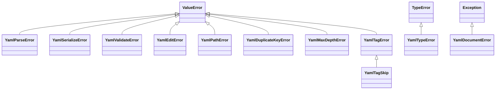

pyrs-yaml はエラーハンドリング用にカスタム例外クラスを定義しています。



## YamlParseError

YAML パースに失敗した場合にスローされます。

```python
class YamlParseError(ValueError):
    """YAML パースエラー（ValueError を継承）。"""
```

**継承元:** `ValueError`

**例:**

```python
try:
    doc = pyrs_yaml.parse("invalid: yaml: [")
except pyrs_yaml.YamlParseError as e:
    print(e)
    # "YAML parse error: mapping values are not allowed in this context at char 13 line 1 column 14"
```

## YamlSerializeError

YAML シリアライズに失敗した場合にスローされます。

```python
class YamlSerializeError(ValueError):
    """YAML シリアライズエラー（ValueError を継承）。"""
```

**継承元:** `ValueError`

書き手が知らない Python オブジェクトは、もう一層手前で
[`YamlTypeError`](#yamltypeerror) として拒否されます：`pyrs_yaml.safe_dump(object())` は
`Unsupported Python type for YAML conversion` と答えます。このクラスは、変換そのものは通った値に
対して出力先の書式が収めきれない場合の受け手であり、メッセージにはその理由キーが安定した形で
入ります。

```python title="try/except の例"
doc = pyrs_yaml.parse("a: .inf")
try:
    text = doc.to_json()
except pyrs_yaml.YamlSerializeError as e:
    print(e)
    # "json-cannot-represent-non-finite"
```

## YamlTypeError

型変換エラーが発生した場合にスローされます。

```python
class YamlTypeError(TypeError):
    """型変換エラー（TypeError を継承）。"""
```

**継承元:** `TypeError`

**例:**

```python
try:
    result = pyrs_yaml.safe_dump(object())  # 変換不可な型
except pyrs_yaml.YamlTypeError as e:
    print(f"型エラー: {e}")
```

## YamlValidateError

JSON Schema 検証が失敗した場合にスローされます。

```python
class YamlValidateError(ValueError):
    """JSON Schema 検証エラー（ValueError を継承）。"""
```

**継承元:** `ValueError`

**例:**

```python
try:
    doc = pyrs_yaml.parse("age: not_a_number")
    doc.validate(schema={"type": "object", "properties": {"age": {"type": "number"}}})
except pyrs_yaml.YamlValidateError as e:
    print(f"検証エラー: {e}")
```

`str` でもマッピングでもないスキーマもこのクラスに届き、エンジン自身の拒否文をそのまま運
びます：`doc.validate(3)` は
`YamlValidateError: TypeError: argument of type 'int' is not iterable` と答えます。

!!! warning "委譲の境界"
    評価は Python の `jsonschema` パッケージへ委譲され、**本プロジェクトが公開するどれにもそれは
    インストールされません**：`[project.dependencies]` は `typing-extensions` だけで、extra は
    `cli`、`pydantic`、`settings` の三つです。だから二つの扉は `Yaml*` のクラスの外に答え、
    どちらもこのビルドで実測しました：

    - `doc.validate({"type": "object"})` は裸の `ModuleNotFoundError` で答えます——
      `YamlValidateError` ではありません。そのテキストはモジュールの欠け方で決まります。
      名前が本当に無いなら `No module named 'jsonschema'` で、`tests/test_validate.py` が
      存在しないホイールを再現する止め方（`sys.modules["jsonschema"] = None`）なら
      `import of jsonschema halted; None in sys.modules` です。
    - `str` のスキーマの扉は評価器の前に `json.loads` を**通す**ので、YAML の綴りの
      スキーマのテキストは `jsonschema` の有無にかかわらず
      `json.decoder.JSONDecodeError: Expecting value: line 1 column 1 (char 0)` と答えます。
      JSON として正しいスキーマのテキストはそのまま評価器まで届き、そこで欠落が答えるのは
      上の `ModuleNotFoundError` です。

    どちらも `pyrs-yaml validate` の CLI の `except YamlValidateError` 節を抜け出ます。だから
    あのコマンドはいつもの `error: …` の行ではなく traceback を印字します。YAML の綴りの
    スキーマではコンソールスクリプト経由で実測しました（stderr に traceback、stdout は空、
    終了コード `1`）。[検証](../guides/cli.md#cmd-validate) を参照してください。

    どちらもこのページが直す欠陥ではありません。両方とも `.ci/known-residuals.json` に
    登記済みの境界で（`api:validate-evaluator-is-not-installed-by-anything-we-ship` と
    `api:validate-schema-text-is-json-only`）、それぞれに再現テストと、それを閉じるための
    終了条件が付いています。

## YamlEditError

インプレース編集を適用できない場合にスローされます。今のビルドで実測したところ、このクラスに届く
拒否は次のとおりです：解決しないパス、スカラーまたは形の違うコンテナへのナビゲーション、インデックス
範囲外、エイリアス**経由**で加えた編集、エイリアスがいまだ参照しているアンカー、ルートや複合キーの
リネームや既存キーへのリネーム、削除対象の重複、そして分からない `on_duplicate` の値。

このクラスが**扱わない**三つのこと（すべて実測）：

- サポートされない Python の値は編集エラーではなく `YamlTypeError` です——
  `doc.set("$.a", {1, 2})` と `doc.set("$.a", object())` は
  `YamlTypeError: Unsupported Python type for YAML conversion` と答えます。`tuple` と `bytes` は
  受け入れられます（`bytes` は `!!binary` になります）。
- 負のインデックスは拒否ではありません——`$.items[-1]` は最後の要素を指します。拒否になるのは
  シーケンスの外側のインデックスだけで、`index-out-of-range-edit` と自分を名乗ります。
- **エイリアス自身のパス**を設定するのも拒否ではありません：
  `pyrs_yaml.parse("base: &x 1\nuse: *x\n").set("$.use", 2)` は成功して `base: &x 1\nuse: 2\n` を
  再出力し、`&x` は参照されないまま残ります。同じ組に対するほかの動詞も同じく静かです——同じ文書で
  実測すると、`delete("$.use")` は `base: &x 1\n` を残し、`rename("$.use", "used")` は
  `base: &x 1\nused: *x\n` を残し、`prod: *d` では `Node.rename("prod2")` がキーを `prod2: *d` へ
  リネームします。例外を上げるのはエイリアス*経由*の編集です。

```python
class YamlEditError(ValueError):
    """インプレース編集エラー（ValueError を継承）。"""
```

**継承元:** `ValueError`

**例:**

```python title="try/except の例"
doc = pyrs_yaml.parse("a:\n  b: 1")

try:
    doc.set("$.a.b.c", 2)  # スカラーへのナビゲーション
except pyrs_yaml.YamlEditError as e:
    print(e)
    # "edit failed: create-needs-mapping"
```

すべてのメッセージとその誘因は[編集理由トークン](#edit-reason-tokens)に列挙しています。

## YamlPathError

JSONPath スタイルのパスが不正または編集不可の場合にスローされます：`$` で始まらないパス、編集操作でのワイルドカード（`[*]`）またはディープスキャン（`..`）セグメントの使用。

```python
class YamlPathError(ValueError):
    """YAML パスエラー（ValueError を継承）。"""
```

**継承元:** `ValueError`

**例:**

```python
doc = pyrs_yaml.parse("items: [1, 2]")

try:
    doc.set("$.items[*]", 3)  # ワイルドカードは編集不可
except pyrs_yaml.YamlPathError as e:
    print(e)
    # "wildcard/deep-scan paths are not editable"
```

このクラスが答える三つのメッセージはいずれも実測済みで、どれも `edit failed:` の
プレフィックスを運びません：

| 編集に渡したパス | 実測した `str(exc)` |
|------------------|---------------------|
| `"items[0]"`、`""`（`$` が無い） | `Path must start with $` |
| `"$.items[*]"`、`"$..b"` | `wildcard/deep-scan paths are not editable` |
| `"$.items[abc]"` | `invalid index in path: $.items[abc]` |

`"$."` はその三つに入りません。末尾のドットは落とされてパスはルートを指すため、
`doc.set("$.", 2)` は文書全体をスカラー `2` に置き換えます。

## YamlDocumentError

`Node` が陳腐化した場合にスローされます — ノード作成後にドキュメントが変更（またはリリース）された。

```python
class YamlDocumentError(Exception):
    """ノードの親 YamlDocument が陳腐化したときにスロー。"""
```

**継承元:** `Exception`

**例:**

```python
node = doc.node().find("$.a")
doc.set("$.b", 2)  # ドキュメントのリビジョンを増加
node.set_value(99)  # RuntimeWarning + YamlDocumentError
```

二つの拒否はそれぞれ固有の文を持ち、どちらも実測済みで、どちらも stderr に出る
`RuntimeWarning` が先に付きます：

| ノードの死に方 | 実測した `str(exc)` |
|----------------|---------------------|
| ノードの作成後にドキュメントが編集された | `document has been modified; re-find the node` |
| `node.release()` が呼ばれた | `parent document has been released` |

`is_valid()` はどちらの状態も報告しません——自分の削除でリビジョンを増やしたノードも
依然として `True` と答え、それを消すのは `release()` だけです。

## YamlDuplicateKeyError

入力に重複マッピングキーが検出された場合にスローされます。

```python
class YamlDuplicateKeyError(ValueError):
    """重複マッピングキーエラー（ValueError を継承）。"""
```

**継承元:** `ValueError`

**例:**

```python
try:
    pyrs_yaml.parse("key: 1\nkey: 2")
except pyrs_yaml.YamlDuplicateKeyError as e:
    print(f"重複キー: {e}")
```

## YamlMaxDepthError

YAML ドキュメントが最大ネスト深度を超えた場合にスローされます。

```python
class YamlMaxDepthError(ValueError):
    """最大ネスト深度超過（ValueError を継承）。"""
```

**継承元:** `ValueError`

**例:**

```python
try:
    pyrs_yaml.parse("a:\n  b:\n    c:\n      ...", max_depth=2)
except pyrs_yaml.YamlMaxDepthError as e:
    print(f"最大深度超過: {e}")
```

## YamlTagError

タグハンドラが無効な名前またはシグネチャで登録された場合にスローされます。

```python
class YamlTagError(ValueError):
    """タグハンドラエラー（ValueError を継承）。"""
```

**継承元:** `ValueError`

## YamlTagSkip

タグハンドラがノードをチェーン内の次のハンドラに渡すために送出するセンチネル例外。どのハンドラも受け入れない場合、ノードはソースの元の値を保ちます。これは実際のエラーではなく、意図的な制御フローシグナルです。

!!! info "制御フローセンチネル"
    `YamlTagSkip` は実際のエラーではありません。タグハンドラがチェーン内の次のハンドラに
    制御を委譲するためのシグナルです。ハンドラからこれをスローすると、
    制御が次のハンドラに渡されます（またはデフォルトにフォールスルーします）。

```python
class YamlTagSkip(YamlTagError):
    """タグハンドラスキップセンチネル（YamlTagError を継承）。"""
```

**継承元:** `YamlTagError`

**例:**

```python
@pyrs_yaml.register_tag("!skip_me")
def handler(node):
    raise pyrs_yaml.YamlTagSkip
```

## 編集理由トークン { #edit-reason-tokens }

`YamlEditError` は、編集がなぜ拒否されたかを安定した小文字のトークンで名乗ります。読む
`.reason` 属性は存在しません：例外クラスが公開するのは `args`、`add_note()`、
`with_traceback()` だけで、トークンはメッセージの内側にあります——
`pyrs_yaml.parse("base: &x 1\nuse: *x\n").delete("$.base")` で実測すると、`exc.args` は単一の
文字列 `("edit failed: anchor-is-referenced",)` です。だから呼び出し側は `str(exc)` の部分文字列
としてトークンを分岐させ、トークンだけでマッチすることもできます。`edit failed:` の
プレフィックスは `set_language()` に追従しますが、トークンは追従しないためです
（[i18n サポート](#i18n-support) を参照）。

以下の各行は今のビルドに対して実行しました。YAML の入力は `\n` で書いています。`parse()` に
渡されるテキストがそれだからです。

| 理由 | それに答える呼び出し | 実測した `str(exc)` |
|------|----------------------|---------------------|
| `anchor-is-referenced` | `pyrs_yaml.parse("base: &x 1\nuse: *x\n")` に対する `delete("$.base")`。ほかにも、そのノードへの `set_anchor()` と `remove_anchor()`、`prod: *defaults` が残っているあいだの `$.defaults` の `delete()`、そしてそこへの `move()` | `edit failed: anchor-is-referenced` |
| `cannot-edit-alias` | `parse("defaults: &d\n  timeout: 30\nprod: *d\n")` に対する `set("$.prod.timeout", 99)`。ほかにも、親がエイリアスであるパスへの `insert()`/`append()`、その内側のキーの `delete()`/`rename()`、エイリアスを経由して到達したノードでの `Node.set_value()` と `Node.delete()`、そしてエイリアスノード自身に呼ばれるすべてのメタデータの動詞——`set_comment()`、`remove_comment()`、`set_leading_comment()`、`remove_leading_comment()`、`set_tag()`、`remove_tag()`、`set_anchor()`、`remove_anchor()`、`set_flow_style()`、`set_scalar_style()`、`set_chomping()`、`sort_keys()` | `edit failed: cannot-edit-alias` |
| `create-needs-mapping` | `parse("a:\n  b: 1\n")` に対する `set("$.a.b.c", 2)`——そのステップがスカラーに着地する。ほかにも、形の違うコンテナ上のコンテナ型のセグメント（`parse("items: [1, 2]\n").set("$.items.name", 2)`）、マッピングへのインデックス（`parse("a: 1\n").set("$.a[0]", 2)`）、スカラールートに対するキー付きの書き込みなら何でも（`parse("just a scalar\n")["b"] = 2`） | `edit failed: create-needs-mapping` |
| `cannot-descend-into-scalar` | `parse("a: 1\n")` に対する `set("$.a.b.c", 2, create_missing=True)`。ほかにも `parse("a: 1\n").insert("$.a.b", 0, 1)`、そしてスカラールートでの `parse("just a scalar\n").set("$.a.b", 2, create_missing=True)` | `edit failed: cannot-descend-into-scalar:b`——拒否されたセグメントはコロンの後に来る（スカラールートなら `…:a`） |
| `missing-path` | `parse("a: 1\n")` に対する `delete("$.zz")`。ほかにも、解決しないパスへの `rename()` と `sort_keys()`、`del doc["zz"]`、そしてミスで `find()` が返す `Node(invalid)` 上のメタデータのセッター | `edit failed: missing-path` |
| `missing-path:<key>` | `parse("a: 1\n")` に対する `set("$.b.c.d", 2)`——**中間**キーの欠落。ほかにも `parse("items: 1\n").insert("$.nope", 0, "z")` と `parse("src:\n  x: 1\n").node().move("$.deep.leaves")` | `edit failed: missing-path:b`——ナビゲーションの層が最初に漏れたキーを名乗る（`missing-path:nope`、`missing-path:deep`） |
| `not-a-sequence` | `parse("a: 1\n")` に対する `insert("$.a", 0, "z")` と `append("$.a", "z")` | `edit failed: not-a-sequence` |
| `index-out-of-range-edit` | `parse("items:\n  - a\n")` に対する `insert("$.items", 42, "z")`。ほかにも `-99` での `insert()`、`delete("$.items[9]")`、二つの要素を持つルートシーケンスでの `delete("$[5]")` | `edit failed: index-out-of-range-edit` |
| `index-out-of-range-edit:<index>` | `parse("items: [1, 2, 3]\n")` に対する `set("$.items[7]", 99)`。ほかにも負の綴り `set("$.items[-99]", 99)`、`parse("items: []\n").set("$.items[2]", 1, create_missing=True)` | `edit failed: index-out-of-range-edit:7`——拒否されたインデックスはコロン後（`…:-99`、`…:2`） |
| `cannot-rename-root` | `parse("a: 1\n")` に対する `rename("$", "b")`。ほかにも `parse("a: 1\n").node().rename("b")` | `edit failed: cannot-rename-root` |
| `cannot-rename-complex-key` | `parse("? [1, 2]\n: value\n")` に対する `rename("$[0]", "b")`。ほかにもマッピング値の複合キー（`? {a: 1}`）、そしてリネームすべきキーを持たないシーケンス要素は任意——`parse("- a\n- b\n").rename("$[0]", "x")` または `Node.children[1].rename("x")` | `edit failed: cannot-rename-complex-key` |
| `rename-key-exists` | `parse("a: 1\nb: 2\n")` に対する `rename("$.a", "b")` | `edit failed: rename-key-exists` |
| `duplicate-key-target` | `parse("a: 1\n!!str a: 2\n")` に対する `delete("$.a", on_duplicate="error")`。ほかにも同じ文書での `node.delete(on_duplicate="error")` | `edit failed: duplicate-key-target` |
| `unknown on_duplicate` | `parse("a: 1\n")` に対する `delete("$.a", on_duplicate="both")` | `edit failed: unknown on_duplicate "both"; expected one, all or error` |
| `edit-error` | `parse("a: 1\n").delete("$")`、`parse("a: 1\n").node().delete()`、`parse("src:\n  x: 1\n").node().move("$.src")`——いずれもセグメント一覧が空、つまりルートそのものの削除をエンジンに頼む | `edit failed: edit-error` |
| *(トークンなし)* | `parse("? [1, 2]\n: value\n").node().children[0].rename("b")`——複合キーはパスセグメントにできない | `ValueError: segment must be str or int` |
| *(スタイルの拒否)* | `parse("a: 1\n").node().find("$.a").set_scalar_style("squiggle")` | `unknown scalar style 'squiggle': expected one of plain, single_quoted, double_quoted, literal, folded` |
| *(chomping の拒否)* | `parse("a: |\n  text\n").node().find("$.a").set_chomping("squiggle")` | `unknown chomping 'squiggle': expected one of strip, clip, keep` |

最後の三行も `YamlEditError` ですが、`edit failed:` のテンプレートを通さず、上げられた場所で
そのまま書かれているためプレフィックスがありません。素の `edit-error` トークンの後ろには二つの
生成者がいます——削除のセグメント一覧が空のときに `editing/plan.rs` がその文字列を返し、
`EditError::Generic` はそれを構成するただ一箇所（パスの最後のセグメントを取る
`editing/region.rs`）から同じトークンを表示します——上のルート形の三つの呼び出しが実務でそこに
届く経路です。キーをそれ自身へリネームするのはまったく拒否ではありません：`rename("$.a", "a")` は
成功して `a: 1` をその位置に残し、`a` と `!!str a` を両方持つ文書での `rename("$.a", "a")` も成功
します——重複方針は `delete()` だけのものだからです。

### どの呼び出しも答えない理由トークン

エンジンのエラー宣言（`crates/pyrs-ast/src/error.rs`）と編集層
（`crates/pyrs-yaml-core/src/editing/plan.rs`）から数え上げた以下の綴りは Rust のソースに
存在しますが、どの Python の呼び出しからも**到達できませんでした**：

- `internal-error: …` —— `EditError::Internal` はツリーのどこにも構成箇所がなく、
  `SerializeError::Internal` はちょうど一箇所
  （`crates/pyrs-yaml-core/src/serializer.rs` の `is_compact_item on non-mapping` の
  不変条件）だけで、そこに Python の呼び出しは到達していません。これで始まるメッセージは、
  処理すべき拒否ではなくバグ報告です。
- `wildcard-or-deep-scan`、`invalid-index:{0}`、`invalid-path` —— `PathError` の列挙型には構成箇所が
  まったくありません。これらのケースで Python の呼び出し側が見るのは上の表の `YamlPathError` の
  テキスト（`Path must start with $` とその二つの兄弟）で、パスが Rust に届く前に
  `python/pyrs_yaml/editing.py` で作られます。
- `duplicate key: <key>` と `max depth exceeded (max=<n>)` は Rust の `Display` の綴りで、それぞれの
  Python クラスは `duplicate key: key`（同じテキスト）と `Maximum YAML depth exceeded (max=2)` と
  答えます。

## エラーメッセージ形式

以下の各形式は、今のビルドに対してプローブが実際に印字したテキストです。`<…>` は
変わる部分を示します。

| 拒否 | 形式 |
|------|------|
| パースエラー | `"YAML parse error: <parser message> at char <N> line <L> column <C>"` |
| 無効な UTF-8 | `"Invalid UTF-8: <detail>"` |
| 重複キー | `"duplicate key: <key>"` |
| 最大深度 | `"Maximum YAML depth exceeded (max=<n>)"` |
| 単一ドキュメント経路での二番目のドキュメント | `"multi-document-input: this input carries a second document at line <L>, column <C> and this route reads one. …"` |
| 分からない読み手の方針 | `'unknown duplicate_keys "<value>"; expected as_is, error, last_wins or first_wins'` |
| Schema 検証失敗 | `"<jsonschema message>"`——例：`'email' is a required property` |
| 編集失敗 | `"edit failed: <reason token>"`——[編集理由トークン](#edit-reason-tokens)を参照 |
| スタイル / chomping の引数 | プレフィックスなしの文：`"unknown scalar style '<value>': expected one of plain, single_quoted, double_quoted, literal, folded"`、`"unknown chomping '<value>': expected one of strip, clip, keep"` |
| 重複方針の引数 | `"edit failed: unknown on_duplicate \"<value>\"; expected one, all or error"` |
| 書き手が値を収められない | 理由キーだけ：`"json-cannot-represent-non-finite"`、`"json-cannot-represent-alias"`、`"toml-unsupported-node"`（エイリアス）、`"toml-requires-table-root"`（シーケンスルート）、`"toml-keys-must-be-scalars"`（複合キー）、`"toml-cannot-represent-null"`、`'unknown note_placement "<value>"; expected note_first or header_first'` |
| サポートされない Python の値 | `"Unsupported Python type for YAML conversion"`——経路が解読できない dtype を持つ ndarray も同じテキスト（`datetime64`、構造化 dtype、`object`） |
| `str` でも `bytes` でもない | `"Expected str or bytes"` |
| コンテナに対して型の違うキー | `"Index must be an integer"` |
| パス不正 | プレフィックスがまったくない：`"Path must start with $"`、`"wildcard/deep-scan paths are not editable"`、`"invalid index in path: <path>"` |
| マッピングのキーが無い | テキストが `"Key '<key>' not found"` の `KeyError` |
| シーケンスのインデックス範囲外 | テキストが `"Index <index> out of range (len=<len>)"` の `IndexError` |
| 陳腐化したノード | `"document has been modified; re-find the node"`、または `"parent document has been released"` |

そのうちの三行は `Yaml*` のクラスではなく、二行はローカライズもされません：

- 読めないファイルは素の `OSError: Failed to read file: <OS message> (os error
  <N>)` で答えます。`<OS message>` の断片はホストから来るため、ホスト自身の言語で
  届きます（このビルドでは存在しないファイルに対して中国語の OS テキストが印字されました）。
  答えに `"File read error: …"` のテンプレートは存在しません。
- `KeyError` と `IndexError` は自前のクォーテーションを持つ組み込み例外なので、`str(exc)` は
  外側の引用符を含んだ `"Key 'zz' not found"` を見せます。そのテキストは `set_language()` に
  追従します。
- パースエラーは決してローカライズされません。`YAML parse error: …` はエンジン自身の言い回しで、
  `zh-CN`、`ja-JP`、`ko-KR` のいずれでも英語で印字されます（実測——
  [i18n サポート](#i18n-support) を参照）。

## i18n サポート { #i18n-support }

四つのロケールがインストールされています——`en`、`zh-CN`、`ja-JP`、`ko-KR`——そして
`pyrs_yaml.detect_language()` が有効なものを報告します。その四つ外の値は組み込みの
`ValueError: Unsupported language: 'xx-XX'. Supported: ["en", "zh-CN", "ja-JP", "ko-KR"]`
で拒否されます。

メッセージのどちら側が動くかは、それがどこで書かれたかに依存します。四つのロケール
すべてで実測しました：

```python title="ローカライズされたエラーメッセージ"
import pyrs_yaml

pyrs_yaml.set_language("zh-CN")
doc = pyrs_yaml.parse("base: &x 1\nuse: *x\n")

try:
    doc.delete("$.base")
except pyrs_yaml.YamlEditError as e:
    print(e)
    # "编辑失败：anchor-is-referenced" — プレフィックスだけが翻訳され、理由トークンはそのまま

try:
    pyrs_yaml.parse("a: b: c")
except pyrs_yaml.YamlParseError as e:
    print(e)
    # "YAML parse error: mapping values are not allowed in this context at char 4 line 1 column 5"
    # — パーサー自身の言い回しで、どのロケールでも英語のまま
```

| メッセージのどの部分 | `set_language()` に追従する？ |
|----------------------|-------------------------------|
| `Yaml*` のテンプレート：`edit failed:`、`Invalid UTF-8:`、`Unsupported Python type for YAML conversion`、`Key '<key>' not found`、`Index <n> out of range (len=<n>)` | はい——編集のプレフィックスでは `编辑失败：`、`編集に失敗しました：`、`편집 실패: ` が実測されました |
| そのプレフィックスの後ろの編集理由トークン（`anchor-is-referenced`、`missing-path:b`、`unknown on_duplicate …`） | いいえ——四つのロケールすべてで英語です。それこそが照合の目印になる理由です |
| パーサーのテキスト（`YAML parse error: …`、`multi-document-input: …`） | いいえ——どこでも英語で、`zh-CN`、`ja-JP`、`ko-KR` の下で実測しました |

`set_language("en")` は英語のテンプレートに戻します。そしてカタログはプロセス全体のもので、
すべての文書で共有され、文書ごとに保存されるのではありません。

## ベストプラクティス

```python
# 具体的な例外をキャッチ
try:
    doc = pyrs_yaml.parse(yaml_content)
except pyrs_yaml.YamlParseError as e:
    logger.error(f"YAML パースエラー: {e}")
    # エラーメッセージの解析
    error_str = str(e)  # "Invalid YAML: line 1, column 15: ..."
except pyrs_yaml.YamlTypeError as e:
    logger.error(f"型エラー: {e}")
```

**注意:** すべてのカスタム例外は `ValueError` を継承しているため、`except ValueError` で一括キャッチできます。ただし、エラーハンドリングを細かく制御する場合は、具体的な例外クラスを使用してください。

## 自動生成の API リファレンス

以下の内容は生成された型スタブから `mkdocstrings` が描画したものなので、各例外に表示される基底クラスはバインディングが実際に宣言しているものです。

::: pyrs_yaml.YamlParseError
::: pyrs_yaml.YamlSerializeError
::: pyrs_yaml.YamlTypeError
::: pyrs_yaml.YamlValidateError
::: pyrs_yaml.YamlEditError
::: pyrs_yaml.YamlPathError
::: pyrs_yaml.YamlMaxDepthError
::: pyrs_yaml.YamlDuplicateKeyError
::: pyrs_yaml.YamlTagError
::: pyrs_yaml.YamlTagSkip
