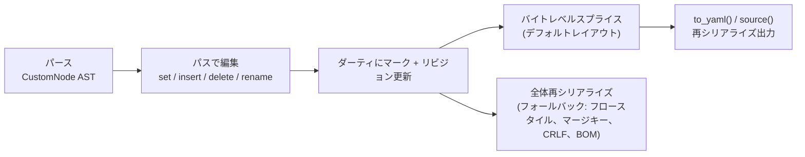

pyrs-yaml では、**パース済みドキュメントをその場で編集**でき、すべてのフォーマットメタデータ（コメント、アンカー、タグ、スカラースタイル、フロー/ブロックスタイル）を保持します — 手作業による文字列加工は不要で、忠実性の損失もありません。

## 概要

編集は、ドキュメントツリーへの **JSONPath スタイルのパス** で表現します：

```python title="パスで編集"
import pyrs_yaml

doc = pyrs_yaml.parse("""
db:
  host: localhost
  port: 5432
""")

doc.set("$.db.host", "db.example.com")  # set by path
doc.set("$.db.port", 5433)
print(doc.to_yaml())
# db:
#   host: db.example.com
#   port: 5433
```

すべての編集メソッドは**アトミック**です：失敗した場合、ドキュメント（リビジョンを含む）は何も変更されません。成功するとドキュメントはダーティとしてマークされ、次の `source()` / `to_yaml()` / `to_yaml_with_options()` / `reparse()` 呼び出しで更新されたツリーから再シリアライズされます。

### 編集パイプライン



## パス構文

パスは `$` で始まり、ドット区切りのキー（マッピング）または `[N]` インデックス（シーケンス）が続きます：

| パス | 意味 |
|------|------|
| `$.host` | ルートマッピングのキー `host` |
| `$.a.b.c` | ネストされたキー |
| `$.items[0]` | シーケンス `items` の最初の要素 |
| `$` | ルートノード自体 |

- **負のインデックス**（`[-1]`、`[-2]`、...）は**サポートされています** — シーケンスの末尾から数えます（Python と同じセマンティクス：`-1` は最後の要素）。範囲外の負のインデックスは `YamlEditError` を発生させ、置けなかったインデックスを名乗ります：`parse("items: [1, 2, 3]\n").set("$.items[-99]", 99)` は `edit failed: index-out-of-range-edit:-99` と答えます
- キーは**値でマッチ**します（メタデータには依存しません）。そのため、クォート付きキー `"host"` はプレーンキー `host` にマッチします

編集パスは正確に 1 つのノードを対象とする必要があります — **ワイルドカード**（`[*]`）と**ディープスキャン**（`..`）は `YamlPathError` を発生させます。（クエリ専用の `find()` ではこれらを使用できます。[`find()` によるクエリ](#find) を参照してください。）

**発生する例外:** 不正なパスでは `YamlPathError` が、パスのステップを適用できない場合は `YamlEditError` が発生します — エイリアスを経由するステップは `edit failed: cannot-edit-alias`、スカラーへのステップは `edit failed: create-needs-mapping` と実測しました。安定している部分は理由のトークンです。[編集理由トークン](../api/exceptions.md#edit-reason-tokens) を参照してください。

## 値の設定

### `set()` — パスによる置換

```python title="set() シグネチャ"
set(path: str, value: Any) -> None
```

```python title="set() 例"
doc = pyrs_yaml.parse("a:\n  b: 1\nitems: [1, 2, 3]")

doc.set("$.a.b", 42)  # scalar → scalar, metadata preserved
doc.set("$.items[1]", "two")  # sequence index
doc.set("$.a.c", True)  # add a new key to a mapping (last position)
doc.set("$", {"x": 1})  # replace the entire root
```

値の変換ルール：

| Python 値 | YAML ノード |
|-----------|-------------|
| :material-format-text: `str`, :material-numeric: `int`, :material-decimal: `float`, :material-toggle-switch: `bool`, :material-null: `None` | 新しいスカラー（値は*再パースされません*） |
| :material-language-python: `dict` | 新しいマッピング（プレーンスタイル） |
| :material-format-list-numbered: `list` | 新しいシーケンス（プレーンスタイル） |
| :material-format-list-numbered: `tuple` | 新しいシーケンス（プレーンスタイル）— `list` と同じノード |
| :material-format-list-numbered: `bytes` | `!!binary` タグを付けた新しいスカラー — `doc.set("$.a", b"hi")` は `a: !!binary aGk=` を出力します |

その表の外側にある Python の型は、編集パスではなく書き手が拒否します：`set("$.a", {1, 2})` と
`set("$.a", object())` で実測すると、どちらも
`YamlTypeError: Unsupported Python type for YAML conversion` と答えます。

既存のスカラーを置換する場合、対象のメタデータ（インラインコメント、アンカー、タグ、クォートスタイル）は**保持**されます — ただし、新しい値がマッピング/シーケンスの場合は、新しいノード自身のフォーマットが採用されます。

#### `__setitem__` — ルート用糖衣構文

```python title="__setitem__ 糖衣構文"
doc["b"] = 2  # equivalent to doc.set("$.b", 2)
```

#### `Node.set_value()` — ノード経由の編集

```python title="set_value()"
node = doc.node().find("$.a.b")  # see "Working with Nodes"
node.set_value(42)
```

## 挿入と追加

どちらも**シーケンスのみ**を対象とします。パスはシーケンスノードに解決される必要があります。

### `insert()` — インデックス位置への挿入

```python title="insert() シグネチャ"
insert(path: str, index: int, value: Any) -> None
```

`index` は現在の長さまで指定できます（`len` に挿入すると末尾への追加になります）。それより大きい値は `YamlEditError: edit failed: index-out-of-range-edit` を発生させ、`-len` より小さい値も同様です — `parse("items:\n  - a\n").insert("$.items", -99, "z")`。負のインデックスは末尾から数えます（`-1` は最後の要素の前に挿入、`-len` は先頭に挿入）。

```python title="insert() 例"
doc = pyrs_yaml.parse("items:\n  - a\n  - c")

doc.insert("$.items", 1, "b")  # items: [a, b, c]
doc.insert("$.items", 0, "first")
doc.insert("$.items", 3, "last")  # index == len appends
doc.insert("$.items", -1, "before-last")  # items: [a, before-last, c]
```

#### `append()` — 末尾に追加

```python title="append() シグネチャ"
append(path: str, value: Any) -> None
```

```python title="append() 例"
doc.append("$.items", "d")
```

#### `Node.append()` / `Node.insert()`

同じ操作を `Node` オブジェクトでも利用できます：

```python title="Node append/insert"
node = doc.node().find("$.items")
node.append("d")
node.insert(1, "x")
```

## 削除

### `delete()` — パスによる削除

```python title="delete() シグネチャ"
delete(path: str, on_duplicate: str = "one") -> None
```

```python title="delete() 例"
doc = pyrs_yaml.parse("a: 1\nb: 2\nc: 3")
doc.delete("$.b")
print(doc.to_yaml())  # a: 1\nc: 3\n — order preserved
```

マッピングの順序は常に保持されます。シーケンスの削除では隙間が詰められます。

ひとつの名前をつづる二つのキーが、読み手が保つタグかアンカーでのみ区別されて並ぶことがあります。そのため一方を消しても、出力を読み戻したときにはもう一方がその名前に応えてしまいます。`delete()` は `on_duplicate` で呼び出し側にどの答えを望むかを尋ねます:

- `one`（既定）はパスが解決するペアを削除します — すべての既存の呼び出し側が持っている振る舞いです。
- `all` はそのキーが答えになり得るすべてのペアを削除します — 出力からも名前が消えます。
- `error` は二つ以上のペアが残っているあいだは `duplicate-key-target` で拒否し、ドキュメントを変更しません。

分からない値は、既定へ黙って落ちるのではなく、それ自体が名前付きの拒否です。`del doc[key]` と `Node.delete()` は既定のままです。

#### `__delitem__` — ルート用糖衣構文

```python title="__delitem__ root sugar"
del doc["b"]  # equivalent to doc.delete("$.b")
```

#### `Node.delete()`

```python title="Node.delete()"
node = doc.node().find("$.b")
node.delete()
```

## リネーム

### `rename()` — マッピングキーのその場リネーム

```python title="rename() シグネチャ"
rename(path: str, new_key: str) -> None
```

パスは**マッピングキー**を指している必要があります（値はそのキーの下にあり、メタデータを保持します）：

```python title="rename() 例"
doc = pyrs_yaml.parse("old: value  # keep me\nnext: 1")
doc.rename("$.old", "new")
print(doc.to_yaml())  # new: value  # keep me\nnext: 1
```

- **位置は保持** — リネームされたキーは元の位置に留まります
- **メタデータは保持** — キーのインラインコメント、スタイル、アンカーはリネームとともに移動します
- ルートや複合（非スカラー）キーのリネーム、および**既存キーへの**リネームは `YamlEditError` を発生させます。メッセージは `edit failed: cannot-rename-root`、`cannot-rename-complex-key`、`rename-key-exists` のいずれかになります（同一キーへのリネームは何も行いません）
- **シーケンス要素**はどちらの経路でもマッピングキーではありません：`parse("- a\n- b\n").rename("$[0]", "x")` と `Node.children[1].rename("x")` はどちらも `edit failed: cannot-rename-complex-key` と答えます
- キーが複合ノードである文書では、`Node` 経由でそれを指しにいくともう一層手前で拒否されます — `parse("? [1, 2]\n: value\n").node().children[0].rename("b")` は `YamlEditError: ValueError: segment must be str or int` と答えます。複合キーはパスセグメントにできないためです

#### `Node.rename()`

```python title="Node.rename()"
node = doc.node().find("$.old")
node.rename("new")
```

## タグとメタデータ

コメント、アンカー、タグはデフォルトでラウンドトリップ時に保持されます。`Node` 経由で読み取り・編集も可能で、編集はその場で再シリアライズされ、他の要素はすべて保持されます。

### メタデータの読み取り

```python title="ノードメタデータの読み取り"
doc = pyrs_yaml.parse("key: !!str value  # note")
node = doc.node().find("$.key")
node.comment  # "note"
node.anchor  # None
node.tag  # "!!str"
```

- `comment` — インラインまたはスタンドアロンのコメントテキスト（`#` プレフィックスなし）、または `None`
- `anchor` — アンカー名、または `None`
- `tag` — YAML タグ文字列、または `None`

#### `Node.set_comment()` / `Node.remove_comment()`

```python title="コメントの設定/削除"
node.set_comment("new note")  # スタンドアロン: ノードの上の行
node.set_comment("inline", standalone=False)  # ノードの後ろにインライン
node.remove_comment()
```

#### `Node.set_anchor()` / `Node.remove_anchor()`

```python title="アンカーの設定/削除"
node.set_anchor("cfg")
node.remove_anchor()
```

アンカーはドキュメント内の別の場所でエイリアスから参照できます。

#### `Node.set_tag()` / `Node.remove_tag()`

```python title="タグの設定/削除"
node.set_tag("!custom")  # ローカルタグ
node.set_tag("!!int")  # プライマリタグ
node.set_tag("!<tag:yaml.org,2002:str>")  # バーベイタムタグ
node.remove_tag()
```

- **エイリアス**ノード（`*ref`）へのメタデータ編集は `YamlEditError: edit failed: cannot-edit-alias` を発生させます — `set_comment()`、`set_tag()`、`set_anchor()` で実測し、参照先のソースノードに対する `remove_anchor()` でも実測しました
- **存在しないパス**へのメタデータ編集は `YamlEditError: edit failed: missing-path` を発生させます — 文書が持たないパスに対して `find()` が返す `Node(invalid)` オブジェクトでも同じです
- **エイリアスがいまだ参照しているアンカー**の設定と削除は拒否されます：アンカー付きノードへの `set_anchor()`/`remove_anchor()` は `YamlEditError: edit failed: anchor-is-referenced` と答えます。エイリアスが残っていなければ同じ呼び出しは成功します — `parse("base: &x 1\n")` に `set_anchor("renamed")` は `base: &renamed 1` を出力します
- 編集後、ノードは**stale** になります — 次にアクセスする前に `doc.node().find(path)` で再検索してください

## ノードの操作

`doc.node()` はドキュメントルートの `Node` を返し、`Node.find(path)` はサブツリーに移動します：

=== "ドキュメントパス API"

    ```python
    node = doc.find("$.db.host")  # navigate by path
    print(node.value)  # "localhost"
    node.set_value("other")  # edit through the node
    print(node.root_type)  # "scalar" | "mapping" | "sequence" | "null"
    ```

=== "Node API"

    ```python
    node = doc.node()  # root node
    node = doc.node().find("$.db.host")  # navigate by path
    print(node.value)  # "localhost"
    node.set_value("other")  # edit through the node
    print(node.root_type)  # "scalar" | "mapping" | "sequence" | "null"
    ```

ノードはツリー API を公開しています：`node.parent`、`node.children`、`node.walk()`（深さ優先イテレーター）、`node.filter(predicate)`、`node.to_yaml()`。

### AST の走査（`doc.walk()` / `doc.scalars()`）

`doc.walk()` と `doc.scalars()` は**Rust バックエンド**の走査メソッドで、AST 全体を Python dict に変換せずに `Node` オブジェクトを生成します。`Node.walk()`（内部で `to_dict()` を呼び出す）とは異なり、これらのメソッドは AST を直接走査します：

```python title="Rust バックエンドの走査"
doc = pyrs_yaml.parse("a:\n  b: 1\n  c: 2\n")

# すべてのノードを走査（深さ優先、先行順）
for node in doc.walk():
    print(node._path, node.root_type)
# ()       mapping
# ('a',)   mapping
# ('a', 'b') scalar
# ('a', 'c') scalar

# スカラー/null ノードのみを走査
for node in doc.scalars():
    print(node._path, node.value)
# ('a', 'b') 1
# ('a', 'c') 2
```

これは、特にパス情報やスカラー値のみが必要な場合、大規模ドキュメントに対して Python のみの `Node.walk()` よりも大幅に高速です。

#### 不足キーの自動作成（`create_missing=True`）

デフォルトでは、`set()` はパス内の中間キーが存在しない場合に `YamlEditError` を発生させます。`create_missing=True` を指定すると、不足している中間マッピングキーが自動的に作成されます：

```python title="create_missing 例"
doc = pyrs_yaml.parse("a: 1\n")

# create_missing なし — エラー
doc.set("$.b.c.d", 2)  # YamlEditError: missing path

# create_missing あり — b → c → d を作成
doc.set("$.b.c.d", 2, create_missing=True)
print(doc.to_yaml())
# a: 1
# b:
#   c:
#     d: 2
```

ルール：

- 不足している**マッピングキー**は、ネストされたマッピングとして作成されます
- 不足している**インデックスセグメント**はエラーになります（シーケンス要素は自動生成できません）— 実測：`parse("items: []\n").set("$.items[2]", 1, create_missing=True)` は `edit failed: index-out-of-range-edit:2` と答えます
- 途中に**スカラー**がある場合もエラーになります（スカラー内には降下できません）— 実測：`parse("a: 1\n").set("$.a.b.c", 2, create_missing=True)` は `edit failed: cannot-descend-into-scalar:b` と答え、通過を拒否したセグメントを名乗ります。`create_missing` がなければ同じ形で `edit failed: create-needs-mapping` が答えます
- 作成されたチェーンはインプレーススプライス編集の対象になります

#### `find()` によるクエリ

`find()` は**読み取り指向**で、ワイルドカードとディープスキャンをサポートします — パスが複数のノードを選択する場合はリストを返します：

```python title="find() ワイルドカード"
doc.node().find("$.items[*]")  # all items of a sequence (list of Nodes)
doc.node().find("$..timeout")  # deep search for any key named "timeout"
```

ワイルドカード/ディープスキャンの結果は `set()` では**直接編集できません** — 一度の呼び出しでワイルドカードパスに値を適用するには `doc.set_many()` を使用します（下記）。

### 一括・構造編集

#### `doc.set_many()` — 複数値を一度に設定

複数のパスを単一のスプライスバーストで設定します。パスにワイルドカード（`[*]`）やディープスキャン（`..`）を含められます — 一致するすべてのノードが設定されます：

```python title="set_many()"
doc = pyrs_yaml.parse("items:\n  - pass: true\n  - pass: true\n")
doc.set_many(
    {
        "$.items[*].pass": False,  # ワイルドカード: 全アイテム
        "$.name": "config",  # 通常パス
    }
)
```

#### `doc.sort_keys()` — マッピングキーの並べ替え

マッピング（デフォルト: ルート）のキーをその場で並べ替えます：

```python title="sort_keys() 例"
doc = pyrs_yaml.parse("z: 1\na: 2\nm: 3\n")
doc.sort_keys()  # ルートマッピングを並べ替え
print(doc.to_yaml())  # a: 2\nm: 3\nz: 1
```

#### `Node.move(new_path)` — サブツリーの移動

サブツリーを同じドキュメント内の新しいパスへ移動します（コピー後にソースを削除）：

```python title="Node.move() 例"
doc = pyrs_yaml.parse("src:\n  x: 1\ndst: {}\n")
doc.node().find("$.src").move("$.dst")
print(doc.to_yaml())  # dst:\n  x: 1
```

その契約の実測した境界：

- 行き先は**存在しなくてもよい** — その親が存在していれば足ります：`parse("src:\n  x: 1\n").node().find("$.src").move("$.nope")` は `nope:\n  x: 1` を残します。**中間キー**が欠けた行き先は拒否されます — `move("$.deep.leaves")` は `edit failed: missing-path:deep` と答えます
- 既存の行き先の値を置き換えるのは、その値が何でも動きます。スカラーも含みます：`dst: 2` は `dst:\n  x: 1` になります
- 部分木を**自分のパスへ**移すのは拒否されず、文書は空になります — `src:\n  x: 1` での `find("$.src").move("$.src")` は空のマッピング `{}` を出力します
- **ルート**の移動は拒否されます：`pyrs_yaml.parse("src:\n  x: 1\n").node().move("$.src")` は `edit failed: edit-error` と答えます
- まだ参照中のエイリアスを持つ値のパスへ移すのは `edit failed: anchor-is-referenced` と答えます

#### `Node.path` / `Node.find_first()` / `Node.value_eq()`

```python title="Node の内省"
node = doc.node().find("$.a.b")
node.path  # ('a', 'b') — パスセグメント
doc.node().find_first("$.items[*]")  # 最初のワイルドカード一致または None
node.value_eq(other_node)  # 解決後の値を比較（参照同一性ではない）
```

## エイリアスとマージキー

!!! warning "エイリアス越しの編集"
    エイリアスノードを通過するナビゲーション（たとえば `*defaults` の中のキーを設定する）は
    `YamlEditError: edit failed: cannot-edit-alias` を発生させます。参照先ノードは別の場所
    にあるので、エイリアス参照を経由しては編集できません。あらゆる編集経路で実測しました：
    パスのステップがエイリアスに着地するとき、`set()`、`insert()`、`append()`、`delete()`、
    `rename()` とメタデータのセッターはいずれも同じトークンで答え、`find()` を経由して
    解決したノードでの `Node.set_value()` と `Node.delete()` も同じです。

エイリアスノード（`*name`）は、その自身のパスが設定されると**その場で**置き換えられます — これは
エラーではなく、アンカーはそれを定義したノードに残ります：

```python title="エイリアスの置換"
yaml = "defaults: &defaults\n  timeout: 30\nprod: *defaults\n"
doc = pyrs_yaml.YAML(typ="safe").parse(yaml)  # parse() keeps the alias node; safe_load() resolves it

doc.set("$.prod", {"timeout": 99})  # replaces the alias node — prod.timeout: 99
```

スカラーのエイリアスでも同じです：`pyrs_yaml.parse("base: &x 1\nuse: *x\n").set("$.use", 2)` は
成功して `base: &x 1\nuse: 2\n` を再出力し、`&x` は参照するエイリアスのないまま残ります。同じ組に
対するほかの動詞も同じく静かです — 同じ文書で実測すると、`delete("$.use")` は `base: &x 1\n` を
残し、`rename("$.use", "used")` は `base: &x 1\nused: *x\n` を残します。`resolve_merges` は
`parse()` と `reparse()` のキーワードで、`YAML()` コンストラクタのものではありません —
実測：`YAML(resolve_merges=False)` は `TypeError` を発生させます。

- エイリアス**経由**の設定（`*defaults` を通過してマージされたキーに到達する）は `YamlEditError` を発生させます — 参照先ノードは別の場所にあります
- マージキーを解決した場合（デフォルト）、マージ展開されたキーはクローンです。それらを編集してもクローンのみが編集されます。`defaults: &d\n  timeout: 30\n  retries: 3\nprod:\n  <<: *d\n  name: p\n` で実測すると、`set("$.prod.timeout", 99)` は `timeout: 99` を含む `prod` を再出力し、`defaults.timeout` は `30` のまま残ります
- アンカーが**いまだエイリアスに参照されている**ノードの削除は拒否されます：`pyrs_yaml.parse("base: &x 1\nuse: *x\n").delete("$.base")` は `YamlEditError: edit failed: anchor-is-referenced` と答え、同じトークンはそのノードへの `set_anchor()`/`remove_anchor()` と、そのパスへの `move()` からも答えます。誰も指していないアンカー付きノードは普通に削除できます — `parse("keep: &k 1\nother: 2\n").delete("$.keep")` は `other: 2` を残します — 最後のエイリアスが消えればソースも削除されます
- エイリアスを裸の綴り `*a: value` で**キー**として指すことはできません — どの編集が走るよりも前に読み手が拒否します（`YamlParseError: YAML parse error: simple key expected ':' at char 15 line 2 column 1`）。明示的なキーの形 `anchor: &a key\n? *a\n: value\n` は解析され、そこでの保護は上のアンカーの規則です：`delete("$.anchor")` は `anchor-is-referenced` と答え、`set("$.anchor", "other")` は成功します

## ビューと AST

`doc.get()` / `doc.to_dict()` は**ビュー**（解決された値）を返します。編集は常に**AST**に対して行われます：

```python title="ビューと AST の例"
doc = pyrs_yaml.parse("on: yes")
print(doc.get("on"))  # True   — view (core schema resolution)
doc.set("$.on", "off")  #         — edits the AST scalar
print(doc.to_yaml())  # on: off — serialized verbatim, no re-resolution
```

編集された値は**そのまま**出力されます。ビューはアクティブなスキーマに従ってそれを解決します。

## 陳腐化したノード

`Node` はドキュメントの**リビジョン**に結び付けられており、ノードの作成時に記録されます。ドキュメントの編集（別のノード経由でも）はリビジョンを増加させるため、以前に取得したノードは陳腐化します：

```python title="期限切れノードの例"
node = doc.node().find("$.a")
doc.set("$.b", 2)  # bumps the revision
node.set_value(99)  # RuntimeWarning + YamlDocumentError (stale)
```

編集後はノードを再取得して作業を続けてください。`node.is_valid()` は生存性をチェックし、`node.release()` はノードをドキュメントから明示的に切り離します。

## エラーハンドリング

| エラー | 発生時 | メッセージで実測した理由 |
|-------|--------|------------------------------|
| :material-alert: `YamlPathError` | 不正なパス、編集パスでのワイルドカード/`..` の使用 | *(プレフィックスなし)* `Path must start with $`、`wildcard/deep-scan paths are not editable`、`invalid index in path: <path>` |
| :material-alert: `YamlEditError` | エイリアス**経由**の編集 | `edit failed: cannot-edit-alias` |
| :material-alert: `YamlEditError` | エイリアスがいまだ参照しているアンカー — その削除、再アンカー、そこへの移動 | `edit failed: anchor-is-referenced` |
| :material-alert: `YamlEditError` | スカラーへのナビゲーション、または形の違うコンテナ上のコンテナ型のセグメント | `edit failed: create-needs-mapping` |
| :material-alert: `YamlEditError` | 解決しないパスのステップ | `edit failed: missing-path`。中間キーが漏れた場合は `missing-path:<key>` |
| :material-alert: `YamlEditError` | インデックス範囲外（正負どちら）、`len` を越えた `insert()` | `edit failed: index-out-of-range-edit`。`set()` からは `…:<index>` |
| :material-alert: `YamlEditError` | シーケンスでないものへの `insert()`/`append()` | `edit failed: not-a-sequence` |
| :material-alert: `YamlEditError` | ルート/複合/既存キーのリネーム | `edit failed: cannot-rename-root`、`cannot-rename-complex-key`、`rename-key-exists` |
| :material-alert: `YamlEditError` | 三つのどれでもない `on_duplicate` の引数 | `edit failed: unknown on_duplicate "<value>"; expected one, all or error` |
| :material-alert: `YamlTypeError` | 書き手が知らない Python 型の値（`set("$.a", object())`、`set("$.a", {1, 2})`）— `tuple` と `bytes` は**その中に当たりません** | `Unsupported Python type for YAML conversion` |
| :material-alert: `YamlDocumentError` | ドキュメント編集後に陳腐化した `Node` を使用 | `document has been modified; re-find the node` |

上の拒否はすべて今のビルドに対して実行しました。完全な語彙 — 汎用の
`edit failed: edit-error` で答えるルート形の削除と、どの呼び出しも届かないトークンを含む —
は[編集理由トークン](../api/exceptions.md#edit-reason-tokens)に表にしてあります。理由が
現れる場所は `str(exc)` だけです。これらのクラスに `.reason` 属性はありません。

すべての編集はアトミックです — 失敗した編集はドキュメント（とそのリビジョン）に影響を与えません。

## 完全な例

```python title="編集の完全な例"
import pyrs_yaml

doc = pyrs_yaml.parse("""
# server config
server:
  host: localhost  # bind address
  ports:
    - 8080
    - 9090
""")

doc.set("$.server.host", "0.0.0.0")
doc.insert("$.server.ports", 0, 80)
doc.append("$.server.ports", 443)
doc.rename("$.server", "srv")

print(doc.to_yaml())
# server config
# srv:
#   host: 0.0.0.0  # bind address
#   ports:
#     - 80
#     - 8080
#     - 9090
#     - 443
```

コメント、アンカー、タグ、スカラースタイル、フロー/ブロックフォーマットはすべて保持されます。

## パフォーマンス

!!! tip "バイトレベルスプライス編集"
    デフォルトレイアウトのドキュメントでは、編集は未変更テキストをそのままコピーするバイトレベルのスプライスとして適用され、全再シリアライズと比較して**最大100倍高速**になります。

**フォールバック**（全再シリアライズ）は以下で発生します：

- 編集されたノードまたはその祖先が**フロースタイル**（`{...}`、`[...]`）を使用
- ドキュメントが**非デフォルトレイアウト**（CRLF行末、BOM、非標準インデント）
- ドキュメントに**マージキー**（`<<: *anchor`）が含まれる
- 単一文字列から複数ドキュメントが解析された
- スプライス状態が以前の materialize で**消費**された（シングルバーストモデル）

すべてのフォールバックケースで、正確性は保証されます — パフォーマンス上の利点のみが失われます。

### ベンチマーク

```text title="ベンチマーク結果"
Benchmark                   Median
serialize_10mb             17 ms
edit_flush_set_10mb       110 ms
edit_flush_burst5_10mb    119 ms
```

500グループ×838キーの合成10MBブロックマッピングドキュメントで測定。比率はASTクローンコスト（56ms）が支配的；実際の編集+materializeは約54ms（シリアライズの3倍）。コメント、アンカー、タグを含む複雑なドキュメントでは、スプライスの利点が大幅に拡大します。

---

### 関連項目

- [YAML のパース](parsing.md) — 編集前のドキュメントパース
- [ストリーム解析](streaming.md) — 大規模ファイルのインクリメンタル解析
- [設定管理](tutorial-config-management.md) — エンドツーエンドの編集チュートリアル
