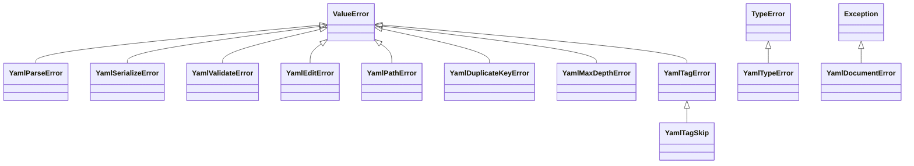

pyrs-yaml는 오류 처리를 위해 사용자 정의 예외 클래스를 정의합니다.



## YamlParseError

YAML 파싱이 실패할 때 발생합니다.

```python
class YamlParseError(ValueError):
    """YAML 파싱 오류 (ValueError 상속)."""
```

**상속:** `ValueError`

**예시:**

```python
try:
    doc = pyrs_yaml.parse("invalid: yaml: [")
except pyrs_yaml.YamlParseError as e:
    print(e)
    # "YAML parse error: mapping values are not allowed in this context at char 13 line 1 column 14"
```

## YamlSerializeError

YAML 직렬화가 실패할 때 발생합니다.

```python
class YamlSerializeError(ValueError):
    """YAML 직렬화 오류 (ValueError 상속)."""
```

**상속:** `ValueError`

작성자가 알지 못하는 Python 객체는 한 층 앞에서
[`YamlTypeError`](#yamltypeerror)로 거부됩니다: `pyrs_yaml.safe_dump(object())`는
`Unsupported Python type for YAML conversion`으로 답합니다. 이 클래스는 변환은 잘 됐는데 대상
형식이 그 값을 담을 자리가 모자를 때이며, 메시지에 그 이유를 밝히는 안정된 이유 키가 실립니다.

```python
doc = pyrs_yaml.parse("a: .inf")
try:
    text = doc.to_json()
except pyrs_yaml.YamlSerializeError as e:
    print(e)
    # "json-cannot-represent-non-finite"
```

## YamlTypeError

타입 변환 오류가 발생할 때 발생합니다.

```python
class YamlTypeError(TypeError):
    """타입 변환 오류 (TypeError 상속)."""
```

**상속:** `TypeError`

**예시:**

```python
try:
    result = pyrs_yaml.safe_dump(object())  # 변환 불가능한 타입
except pyrs_yaml.YamlTypeError as e:
    print(f"타입 오류: {e}")
```

## YamlValidateError

JSON Schema 검증이 실패할 때 발생합니다.

```python
class YamlValidateError(ValueError):
    """JSON Schema 검증 오류 (ValueError 상속)."""
```

**상속:** `ValueError`

**예시:**

```python
try:
    doc = pyrs_yaml.parse("age: not_a_number")
    doc.validate(schema={"type": "object", "properties": {"age": {"type": "number"}}})
except pyrs_yaml.YamlValidateError as e:
    print(f"검증 오류: {e}")
```

`str`도 매핑도 아닌 스키마 역시 여전히 이 클래스로 오며, 엔진 자신의 거부 문장을 텍스트로
실습니다: `doc.validate(3)`는
`YamlValidateError: TypeError: argument of type 'int' is not iterable`로 답합니다.

!!! warning "위임 경계"
    평가는 Python의 `jsonschema` 패키지에 위임되는데, **이 프로젝트가 배포하는 무엇도 그
    패키지를 설치하지 않습니다**: `[project.dependencies]`는 `typing-extensions` 하나이고 세 개의
    extras는 `cli`, `pydantic`, `settings`입니다. 그래서 두 길은 `Yaml*` 클래스 밖에서 답하며,
    둘 다 이 빌드에서 측정했습니다:

    - `doc.validate({"type": "object"})`는 맨 `ModuleNotFoundError`로 답합니다 —
      `YamlValidateError`가 아닙니다. 그 문구는 모듈이 어떻게 빠져 있느냐에 따라 달라집니다: 이름이
      실제로 없으면 `No module named 'jsonschema'`이고, `tests/test_validate.py`가 없는 휠을
      재현하는 방식(`sys.modules["jsonschema"] = None`)으로 중단되면
      `import of jsonschema halted; None in sys.modules`입니다.
    - `str` 스키마 길은 평가 엔진 **앞에** `json.loads`를 거치므로, YAML로 철자한 스키마 텍스트는
      `jsonschema` 설치 여부와 상관없이
      `json.decoder.JSONDecodeError: Expecting value: line 1 column 1 (char 0)`로 답합니다.
      JSON으로 유효한 스키마 텍스트는 여전히 평가 엔진까지
      닿고, 거기서 빠져 있는 모듈은 위 내용의 `ModuleNotFoundError`입니다.

    둘 다 `pyrs-yaml validate`의 CLI `except YamlValidateError` 절을 빠져나갑니다 — 그래서 그
    명령은 `error: …` 줄 대신 traceback을 출력합니다 — YAML로 철자한 스키마에 대해 콘솔
    스크립트로 측정했습니다(stderr의 traceback, 빈 stdout, 종료 코드 `1`) —
    [검증](../guides/cli.md#cmd-validate)을 참고하세요.

    둘 다 이 페이지가 고치는 결함이 아닙니다. 둘 다 `.ci/known-residuals.json`에 등록된
    경계입니다 — `api:validate-evaluator-is-not-installed-by-anything-we-ship`과
    `api:validate-schema-text-is-json-only` — 각각 재현 테스트와 그것을 닫는 출구 조건을
    함께 실습니다.

## YamlEditError

제자리 편집을 적용할 수 없을 때 발생합니다. 현재 빌드에서 측정하면, 이 클래스까지 닿는 거부는
다음입니다: 해석되지 않는 경로, 스칼라로의 탐색이거나 모양이 맞지 않는 컨테이너로의 탐색,
범위를 벗어난 인덱스, 별칭 **을 통한** 편집, 별칭이 아직 참조하는 앵커, 루트나 복합
키나 기존 키로의 이름 변경, 중복된 삭제 대상, 알 수 없는 `on_duplicate` 값.

이 클래스가 다루지 **않는** 세 가지, 모두 측정했습니다:

- 지원되지 않는 Python 값은 편집 오류가 아니라 `YamlTypeError`입니다 — `doc.set("$.a", {1, 2})`와
  `doc.set("$.a", object())`은 `YamlTypeError: Unsupported Python type for YAML conversion`으로
  답합니다. `tuple`과 `bytes`는 허용됩니다(`bytes`는 `!!binary`가 됩니다).
- 음수 인덱스는 거부가 아닙니다 — `$.items[-1]`은 마지막 요소를 가리킵니다. 시퀀스를 벗어난
  인덱스만 거부되고, 그 이름은 `index-out-of-range-edit`입니다.
- **별칭 자체의 경로**에 설정하는 것도 거부가 아닙니다:
  `pyrs_yaml.parse("base: &x 1\nuse: *x\n").set("$.use", 2)`는 성공하고
  `base: &x 1\nuse: 2\n`를 다시 발출하며, `&x`는 그것을 참조할 별칭이 남지 않습니다. 그 짝에 대한 다른
  동사들도 똑같이 조용합니다 — 같은 문서에서 측정하면 `delete("$.use")`는 `base: &x 1\n`를,
  `rename("$.use", "used")`는 `base: &x 1\nused: *x\n`를 남기고, `prod: *d`에서는
  `Node.rename("prod2")`가 키를 `prod2: *d`로 바꿉니다. 별칭 *을 통한* 편집이 발생시키는 쪽입니다.

```python
class YamlEditError(ValueError):
    """제자리 편집 오류 (ValueError 상속)."""
```

**상속:** `ValueError`

**예시:**

```python
doc = pyrs_yaml.parse("a:\n  b: 1")

try:
    doc.set("$.a.b.c", 2)  # 스칼라로의 탐색
except pyrs_yaml.YamlEditError as e:
    print(e)
    # "edit failed: create-needs-mapping"
```

모든 메시지는 그 발생 조건과 함께 [편집 이유 토큰](#edit-reason-tokens)에 정리되어 있습니다.

## YamlPathError

JSONPath 스타일 경로가 잘못되었거나 편집할 수 없을 때 발생합니다: `$`로 시작하지 않는 경로, 편집 작업에서 와일드카드 (`[*]`) 또는 딥 스캔 (`..`) 세그먼트 사용.

```python
class YamlPathError(ValueError):
    """YAML 경로 오류 (ValueError 상속)."""
```

**상속:** `ValueError`

**예시:**

```python
doc = pyrs_yaml.parse("items: [1, 2]")

try:
    doc.set("$.items[*]", 3)  # 와일드카드는 편집 불가
except pyrs_yaml.YamlPathError as e:
    print(e)
    # "wildcard/deep-scan paths are not editable"
```

이 클래스가 답하는 세 메시지는 모두 측정됐고, 어느 것에도 `edit failed:` 접두사가 붙지
않습니다:

| 편집에 넘긴 경로 | 측정된 `str(exc)` |
|------------------------|---------------------|
| `"items[0]"`, `""` (맨 앞의 `$` 없음) | `Path must start with $` |
| `"$.items[*]"`, `"$..b"` | `wildcard/deep-scan paths are not editable` |
| `"$.items[abc]"` | `invalid index in path: $.items[abc]` |

`"$."`는 그 셋에 들지 않습니다: 맨 뒤의 점은 버려지고 경로는 루트를 가리키므로,
`doc.set("$.", 2)`는 문서 전체를 스칼라 `2`로 교체합니다.

## YamlDocumentError

`Node`가 오래된(stale) 상태일 때 발생합니다 — 노드 생성 후 문서가 수정(또는 해제)됨.

```python
class YamlDocumentError(Exception):
    """노드의 부모 YamlDocument가 오래된 경우 발생."""
```

**상속:** `Exception`

**예시:**

```python
node = doc.node().find("$.a")
doc.set("$.b", 2)  # 문서 리비전 증가
node.set_value(99)  # RuntimeWarning + YamlDocumentError
```

두 거부는 저마다의 문장을 실으며, 둘 다 측정됐고, 둘 다 stderr의 `RuntimeWarning`이 먼저
나옵니다:

| 노드가 죽은 방법 | 측정된 `str(exc)` |
|-------------------|---------------------|
| 노드를 만든 뒤에 문서가 편집됨 | `document has been modified; re-find the node` |
| `node.release()`가 호출됨 | `parent document has been released` |

`is_valid()`는 그 두 상태를 알려 주지 않습니다 — 자기 삭제 때문에 리비전이 올라간 노드도
여전히 `True`로 답합니다; 지우는 것은 `release()`뿐입니다.

## YamlDuplicateKeyError

입력에서 중복 매핑 키가 감지될 때 발생합니다.

```python
class YamlDuplicateKeyError(ValueError):
    """중복 매핑 키 오류 (ValueError 상속)."""
```

**상속:** `ValueError`

**예시:**

```python
try:
    pyrs_yaml.parse("key: 1\nkey: 2")
except pyrs_yaml.YamlDuplicateKeyError as e:
    print(f"중복 키: {e}")
```

## YamlMaxDepthError

YAML 문서가 최대 중첩 깊이를 초과할 때 발생합니다.

```python
class YamlMaxDepthError(ValueError):
    """최대 중첩 깊이 초과 (ValueError 상속)."""
```

**상속:** `ValueError`

**예시:**

```python
try:
    pyrs_yaml.parse("a:\n  b:\n    c:\n      ...", max_depth=2)
except pyrs_yaml.YamlMaxDepthError as e:
    print(f"최대 깊이 초과: {e}")
```

## YamlTagError

태그 핸들러가 유효하지 않은 이름이나 시그니처로 등록될 때 발생합니다.

```python
class YamlTagError(ValueError):
    """태그 핸들러 오류 (ValueError 상속)."""
```

**상속:** `ValueError`

## YamlTagSkip

태그 핸들러가 노드를 체인의 다음 핸들러로 넘기기 위해 발생시키는 센티널 예외입니다. 어떤 핸들러도 받아들이지 않으면 노드는 소스의 원래 값을 유지합니다. 이는 실제 오류가 아닌 의도적인 제어 흐름 신호입니다.

!!! info "제어 흐름 센티널"
    `YamlTagSkip`은 실제 오류가 아닙니다. 태그 핸들러가 체인의 다음 핸들러로
    제어를 위임하기 위한 신호입니다. 핸들러에서 이를 발생시키면
    제어가 다음 핸들러로 전달됩니다（또는 기본값으로 폴스루됩니다）。

```python
class YamlTagSkip(YamlTagError):
    """태그 핸들러 스킵 센티널 (YamlTagError 상속)."""
```

**상속:** `YamlTagError`

**예시:**

```python
@pyrs_yaml.register_tag("!skip_me")
def handler(node):
    raise pyrs_yaml.YamlTagSkip
```

## 편집 이유 토큰 { #edit-reason-tokens }

`YamlEditError`는 안정된 소문자 토큰으로 편집이 거부된 *이유*를 이름 지습니다. 읽을 수 있는
`.reason` 속성은 없습니다: 예외 클래스는 `args`, `add_note()`, `with_traceback()`만 공개하고
토큰은 메시지 안에 들어가 있습니다 — `pyrs_yaml.parse("base: &x 1\nuse: *x\n").delete("$.base")`에서
측정하면 `exc.args`는 문자열 하나짜리 `("edit failed: anchor-is-referenced",)`입니다. 그래서
호출하는 쪽은 `str(exc)`의 부분 문자열로 토큰을 판별하며, 토큰만으로 일치시켜도 됩니다:
`edit failed:` 접두어는 `set_language()`를 따르지만 토큰은 따르지 않습니다
([i18n 지원](#i18n-support) 참고).

아래 각 행은 현재 빌드에 대해 실행했습니다. YAML 입력은 `parse()`에 넘기는 텍스트 그대로
`\n`로 적었습니다.

| 이유                              | 답하는 호출들                                                                                                                                                                                                                                                                                                                                                                                                                                                                                                                                   | 측정된 `str(exc)`                                                                                                    |
| --------------------------------- | ----------------------------------------------------------------------------------------------------------------------------------------------------------------------------------------------------------------------------------------------------------------------------------------------------------------------------------------------------------------------------------------------------------------------------------------------------------------------------------------------------------------------------------------------- | -------------------------------------------------------------------------------------------------------------------- |
| `anchor-is-referenced`            | `pyrs_yaml.parse("base: &x 1\nuse: *x\n")`에서의 `delete("$.base")`; 그 노드에 대한 `set_anchor()`와 `remove_anchor()`, `prod: *defaults`가 살아 있는 동안 `$.defaults`를 `delete()`, 그리고 그 위로 `move()`                                                                                                                                                                                                                                                                                                                                   | `edit failed: anchor-is-referenced`                                                                                  |
| `cannot-edit-alias`               | `parse("defaults: &d\n  timeout: 30\nprod: *d\n")`에서의 `set("$.prod.timeout", 99)`; 부모가 별칭인 경로에 대한 `insert()`/`append()`, 그 안의 키에 대한 `delete()`/`rename()`, 별칭을 통해 닿은 노드에 대한 `Node.set_value()`와 `Node.delete()`, 그리고 별칭 노드 자신에서 부르는 메타데이터 동사 전부 — `set_comment()`, `remove_comment()`, `set_leading_comment()`, `remove_leading_comment()`, `set_tag()`, `remove_tag()`, `set_anchor()`, `remove_anchor()`, `set_flow_style()`, `set_scalar_style()`, `set_chomping()`과 `sort_keys()` | `edit failed: cannot-edit-alias`                                                                                     |
| `create-needs-mapping`            | `parse("a:\n  b: 1\n")`에서의 `set("$.a.b.c", 2)` — 단계가 스칼라에 내려앉습니다; 또한 컨테이너 모양 세그먼트가 모양 다른 컨테이너에 올라간 경우(`parse("items: [1, 2]\n").set("$.items.name", 2)`), 매핑에 대한 인덱스(`parse("a: 1\n").set("$.a[0]", 2)`), 그리고 스칼라 루트에 키로 쓰는 어떤 쓰기(`parse("just a scalar\n")["b"] = 2`)                                                                                                                                                                                                      | `edit failed: create-needs-mapping`                                                                                  |
| `cannot-descend-into-scalar`      | `parse("a: 1\n")`에서의 `set("$.a.b.c", 2, create_missing=True)`; 또한 `parse("a: 1\n").insert("$.a.b", 0, 1)`, 그리고 스칼라 루트에서 `parse("just a scalar\n").set("$.a.b", 2, create_missing=True)`                                                                                                                                                                                                                                                                                                                                          | `edit failed: cannot-descend-into-scalar:b` — 거부된 세그먼트는 콜론 뒤에 옵니다(스칼라 루트는 `…:a`)                |
| `missing-path`                    | `parse("a: 1\n")`에서의 `delete("$.zz")`; 해석되지 않는 경로에 대한 `rename()`과 `sort_keys()`, `del doc["zz"]`, 그리고 문서가 그 경로를 갖고 있지 않을 때 `find()`가 돌려주는 `Node(invalid)`에 대한 메타데이터 설정자                                                                                                                                                                                                                                                                                                                         | `edit failed: missing-path`                                                                                          |
| `missing-path:<key>`              | `parse("a: 1\n")`에서의 `set("$.b.c.d", 2)` — 누락된 곳은 **중간** 키입니다; 또한 `parse("items: 1\n").insert("$.nope", 0, "z")`와 `parse("src:\n  x: 1\n").node().move("$.deep.leaves")`                                                                                                                                                                                                                                                                                                                                                       | `edit failed: missing-path:b` — 탐색 층은 처음 놓친 키를 이름으로 밝힙니다(`missing-path:nope`, `missing-path:deep`) |
| `not-a-sequence`                  | `parse("a: 1\n")`에서의 `insert("$.a", 0, "z")`와 `append("$.a", "z")`                                                                                                                                                                                                                                                                                                                                                                                                                                                                          | `edit failed: not-a-sequence`                                                                                        |
| `index-out-of-range-edit`         | `parse("items:\n  - a\n")`에서의 `insert("$.items", 42, "z")`; 또한 `-99`를 준 `insert()`, `delete("$.items[9]")`, 그리고 항목 두 개짜리 루트 시퀀스에 대한 `delete("$[5]")`                                                                                                                                                                                                                                                                                                                                                                    | `edit failed: index-out-of-range-edit`                                                                               |
| `index-out-of-range-edit:<index>` | `parse("items: [1, 2, 3]\n")`에서의 `set("$.items[7]", 99)`; 또한 음수 철자인 `set("$.items[-99]", 99)`와 `parse("items: []\n").set("$.items[2]", 1, create_missing=True)`                                                                                                                                                                                                                                                                                                                                                                      | `edit failed: index-out-of-range-edit:7` — 거부된 인덱스는 콜론 뒤에 옵니다(`…:-99`, `…:2`)                          |
| `cannot-rename-root`              | `parse("a: 1\n")`에서의 `rename("$", "b")`; 또한 `parse("a: 1\n").node().rename("b")`                                                                                                                                                                                                                                                                                                                                                                                                                                                           | `edit failed: cannot-rename-root`                                                                                    |
| `cannot-rename-complex-key`       | `parse("? [1, 2]\n: value\n")`에서의 `rename("$[0]", "b")`; 또한 매핑을 값으로 갖는 복합 키(`? {a: 1}`), 그리고 이름 변경할 키가 없는 시퀀스 요소는 `parse("- a\n- b\n").rename("$[0]", "x")`나 `Node.children[1].rename("x")`로                                                                                                                                                                                                                                                                                                                | `edit failed: cannot-rename-complex-key`                                                                             |
| `rename-key-exists`               | `parse("a: 1\nb: 2\n")`에서의 `rename("$.a", "b")`                                                                                                                                                                                                                                                                                                                                                                                                                                                                                              | `edit failed: rename-key-exists`                                                                                     |
| `duplicate-key-target`            | `parse("a: 1\n!!str a: 2\n")`에서의 `delete("$.a", on_duplicate="error")`; 또한 같은 문서에서의 `node.delete(on_duplicate="error")`                                                                                                                                                                                                                                                                                                                                                                                                             | `edit failed: duplicate-key-target`                                                                                  |
| `unknown on_duplicate`            | `parse("a: 1\n")`에서의 `delete("$.a", on_duplicate="both")`                                                                                                                                                                                                                                                                                                                                                                                                                                                                                    | `edit failed: unknown on_duplicate "both"; expected one, all or error`                                               |
| `edit-error`                      | `parse("a: 1\n").delete("$")`, `parse("a: 1\n").node().delete()`, `parse("src:\n  x: 1\n").node().move("$.src")` — 각 호출은 세그먼트 목록이 빈 자리, 즉 루트 자체를 지우라고 엔진에 요청합니다                                                                                                                                                                                                                                                                                                                                                 | `edit failed: edit-error`                                                                                            |
| *(토큰 없음)*                     | `parse("? [1, 2]\n: value\n").node().children[0].rename("b")` — 복합 키는 경로 세그먼트가 될 수 없습니다                                                                                                                                                                                                                                                                                                                                                                                                                                        | `ValueError: segment must be str or int`                                                                             |
| *(스타일 거부)*                   | `parse("a: 1\n").node().find("$.a").set_scalar_style("squiggle")`                                                                                                                                                                                                                                                                                                                                                                                                                                                                               | `unknown scalar style 'squiggle': expected one of plain, single_quoted, double_quoted, literal, folded`              |
| *(촙핑 거부)*                     | `parse("a: |\n  text\n").node().find("$.a").set_chomping("squiggle")`                                                                                                                                                                                                                                                                                                                                                                                                                                                                           | `unknown chomping 'squiggle': expected one of strip, clip, keep`                                                     |

마지막 세 행도 `YamlEditError`이긴 하지만, 템플릿을 거치지 않고 발생시키는 자리에서 그대로
적혀 접두사가 없습니다. 접두사 없는 `edit-error` 토큰 뒤에는 두 생산자가 있습니다 —
`editing/plan.rs`는 삭제의 세그먼트 목록이 비어 있을 때 그 문자열을 돌려주고,
`EditError::Generic`은 자기를 만드는 단 한 곳에서 같은 토큰을 표시합니다 —
`editing/region.rs`가 경로의 마지막 세그먼트를 가져오는 자리입니다 — 그리고 위쪽의 루트
모양 호출 세 개가 실제로 거기에 닿습니다. 키를 자기 자신으로 이름 변경하는 것은 거부가
아닙니다: `rename("$.a", "a")`는 성공하고 `a: 1`을 제자리에 그대로 두며, `a`와 `!!str a`를
둘 다 담고 있는 문서에서의 `rename("$.a", "a")`도 성공합니다 — 중복 방침은 `delete()`에만
속합니다.

### 어떤 호출도 답하지 않는 이유 토큰

엔진의 오류 선언(`crates/pyrs-ast/src/error.rs`)과 편집 층
(`crates/pyrs-yaml-core/src/editing/plan.rs`)에서 나열하면, 다음 철자는 Rust 소스에
존재하지만 어떤 Python 호출로도 닿지 **못했습니다**:

- `internal-error: …` — `EditError::Internal`은 트리 어디에도 생성 지점이 없고,
  `SerializeError::Internal`은 정확히 하나를 갖고 있습니다
  (`crates/pyrs-yaml-core/src/serializer.rs`의 `is_compact_item on non-mapping` 불변 조건) —
  거기까지 닿은 Python 호출은 없습니다. 그로 시작하는 메시지는 처리해야 할 거부가 아니라
  버그 신고입니다.
- `wildcard-or-deep-scan`, `invalid-index:{0}`, `invalid-path` — `PathError` 열거형에는 아예
  생성 지점이 없습니다. Python 호출자가 그 경우들에 보는 것은 위 표의 `YamlPathError`
  문장(`Path must start with $`와 그 두 형제)이고, 경로는 Rust에 닿기도 전에
  `python/pyrs_yaml/editing.py`에서 만들어집니다.
- `duplicate key: <key>`와 `max depth exceeded (max=<n>)`은 Rust의 `Display` 철자이고,
  그에 대한 Python 클래스는 `duplicate key: key`(같은 텍스트)와
  `Maximum YAML depth exceeded (max=2)`로 답합니다.

## 오류 메시지 형식

아래 각 형식은 현재 빌드를 대상으로 실행한 점검이 실제로 출력한 텍스트입니다. `<…>`는 변하는 부분을
나타냅니다.

| 거부 | 형식 |
|---------|--------|
| 파싱 오류 | `"YAML parse error: <parser message> at char <N> line <L> column <C>"` |
| 잘못된 UTF-8 | `"Invalid UTF-8: <detail>"` |
| 중복 키 | `"duplicate key: <key>"` |
| 최대 깊이 | `"Maximum YAML depth exceeded (max=<n>)"` |
| 한 문서만 읽는 경로에서 두 번째 문서 | `"multi-document-input: this input carries a second document at line <L>, column <C> and this route reads one. …"` |
| 알 수 없는 읽기 방침 | `'unknown duplicate_keys "<value>"; expected as_is, error, last_wins or first_wins'` |
| 스키마 검증 실패 | `"<jsonschema message>"` — 예를 들어 `'email' is a required property` |
| 편집 실패 | `"edit failed: <reason token>"` — [편집 이유 토큰](#edit-reason-tokens) 참고 |
| 스타일 / 촙핑 인자 | 접두사 없는 문장: `"unknown scalar style '<value>': expected one of plain, single_quoted, double_quoted, literal, folded"`, `"unknown chomping '<value>': expected one of strip, clip, keep"` |
| 중복 방침 인자 | `"edit failed: unknown on_duplicate \"<value>\"; expected one, all or error"` |
| 작성자가 값을 담을 자리가 없음 | 이유 키만: `"json-cannot-represent-non-finite"`, `"json-cannot-represent-alias"`, `"toml-unsupported-node"` (별칭), `"toml-requires-table-root"` (시퀀스 루트), `"toml-keys-must-be-scalars"` (복합 키), `"toml-cannot-represent-null"`, `'unknown note_placement "<value>"; expected note_first or header_first'` |
| 지원되지 않는 Python 값 | `"Unsupported Python type for YAML conversion"` — 경로가 디코딩하지 못하는 dtype(`datetime64`, 구조화된 dtype, `object`)을 가진 ndarray도 같은 텍스트입니다 |
| `str`도 `bytes`도 아님 | `"Expected str or bytes"` |
| 컨테이너에 잘못된 키 종류 | `"Index must be an integer"` |
| 잘못된 경로 | 접두사가 아예 없습니다: `"Path must start with $"`, `"wildcard/deep-scan paths are not editable"`, `"invalid index in path: <path>"` |
| 매핑 키 없음 | 텍스트가 `"Key '<key>' not found"`인 `KeyError` |
| 시퀀스 인덱스 범위 초과 | 텍스트가 `"Index <index> out of range (len=<len>)"`인 `IndexError` |
| 만료된 노드 | `"document has been modified; re-find the node"`, 또는 `"parent document has been released"` |

그중 세 줄은 `Yaml*` 클래스가 아니고, 둘은 현지화되지도 않습니다:

- 읽을 수 없는 파일은 맨 `OSError: Failed to read file: <OS message> (os error <N>)`로 답합니다.
  `<OS message>` 조각은 호스트에서 오므로 호스트 자신의 언어로 도착합니다(이 빌드는 없는 파일에
  대해 중국어 OS 텍스트를 출력했습니다). 답안에는 `"File read error: …"` 템플릿이 없습니다.
- `KeyError`과 `IndexError`는 겉따옴표까지 자기 것인 내장 예외이므로, `str(exc)`는
  `"Key 'zz' not found"`를 바깥 따옴표까지 보여 줍니다. 그 텍스트는 `set_language()`를 따릅니다.
- 파싱 오류는 현지화되지 않습니다. `YAML parse error: …`는 엔진 자신의 문구이고, `zh-CN`,
  `ja-JP`, `ko-KR`에서 모두 영어로 출력됩니다(측정 — [i18n 지원](#i18n-support) 참고).

## i18n 지원 { #i18n-support }

네 개의 로케일이 설치되어 있습니다 — `en`, `zh-CN`, `ja-JP`, `ko-KR` — 그리고
`pyrs_yaml.detect_language()`이 그중 적용 중인 하나를 알려 줍니다. 그 넷 밖의 값은 내장
`ValueError: Unsupported language: 'xx-XX'. Supported: ["en", "zh-CN", "ja-JP", "ko-KR"]`로
거부됩니다.

메시지의 어느 절반이 움직이는지는 그 자리가 어디에서 적혔는지에 달려 있습니다. 네 로케일에서
측정했습니다:

```python
import pyrs_yaml

pyrs_yaml.set_language("zh-CN")
doc = pyrs_yaml.parse("base: &x 1\nuse: *x\n")

try:
    doc.delete("$.base")
except pyrs_yaml.YamlEditError as e:
    print(e)
    # "编辑失败：anchor-is-referenced" — prefix translated, reason token untouched

try:
    pyrs_yaml.parse("a: b: c")
except pyrs_yaml.YamlParseError as e:
    print(e)
    # "YAML parse error: mapping values are not allowed in this context at char 4 line 1 column 5"
    # — the parser's own wording, and it stays English in every locale
```

| 메시지의 부분 | `set_language()`를 따릅니까? |
|-------------------|---------------------------|
| `Yaml*` 템플릿들: `edit failed:`, `Invalid UTF-8:`, `Unsupported Python type for YAML conversion`, `Key '<key>' not found`, `Index <n> out of range (len=<n>)` | 예 — 편집 접두어에 대해 `编辑失败：`, `編集に失敗しました：`, `편집 실패: `가 측정됐습니다 |
| 그 접두어 뒤의 편집 이유 토큰(`anchor-is-referenced`, `missing-path:b`, `unknown on_duplicate …`) | 아니오 — 네 로케일에서 모두 영어이며, 그래서 일치시킬 대상이 바로 그것입니다 |
| 파서 텍스트(`YAML parse error: …`, `multi-document-input: …`) | 아니오 — 어디서나 영어입니다. `zh-CN`, `ja-JP`, `ko-KR`에서 측정했습니다 |

`set_language("en")`은 영어 템플릿을 되돌리고, 그 카탈로그는 프로세스 전체의 것입니다 — 문서마다
저장되지 않고 모든 문서가 공유합니다.

## 모범 사례

```python
# 구체적인 예외 캡처
try:
    doc = pyrs_yaml.parse(yaml_content)
except pyrs_yaml.YamlParseError as e:
    logger.error(f"YAML 파싱 오류: {e}")
    # 오류 메시지 파싱
    error_str = str(e)  # "Invalid YAML: line 1, column 15: ..."
except pyrs_yaml.YamlTypeError as e:
    logger.error(f"타입 오류: {e}")
```

**참고:** 모든 사용자 정의 예외는 `ValueError`를 상속하므로 `except ValueError`로 일괄 캡처할 수 있습니다. 하지만 더 세밀한 오류 처리를 위해서는 구체적인 예외 클래스를 사용하는 것이 좋습니다.

## 자동 생성 API 참조

아래 내용은 생성된 형식 stub에서 `mkdocstrings`가 그려 낸 것이므로, 각 예외에 보이는 기반 클래스는 바인딩이 실제로 선언한 그 클래스입니다.

::: pyrs_yaml.YamlParseError
::: pyrs_yaml.YamlSerializeError
::: pyrs_yaml.YamlTypeError
::: pyrs_yaml.YamlValidateError
::: pyrs_yaml.YamlEditError
::: pyrs_yaml.YamlPathError
::: pyrs_yaml.YamlMaxDepthError
::: pyrs_yaml.YamlDuplicateKeyError
::: pyrs_yaml.YamlTagError
::: pyrs_yaml.YamlTagSkip
