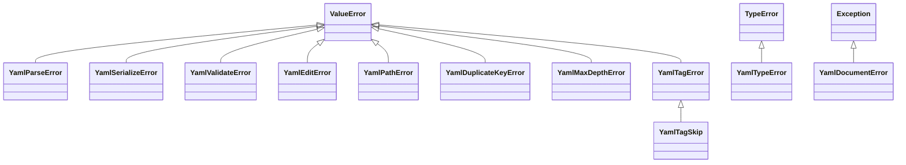

pyrs-yaml 定义了自定义异常类用于错误处理。



## YamlParseError

YAML 解析失败时引发。

```python
class YamlParseError(ValueError):
    """YAML 解析错误（继承自 ValueError）。"""
```

**继承自:** `ValueError`

**示例:**

```python
try:
    doc = pyrs_yaml.parse("invalid: yaml: [")
except pyrs_yaml.YamlParseError as e:
    print(e)
    # "YAML parse error: mapping values are not allowed in this context at char 13 line 1 column 14"
```

## YamlSerializeError

YAML 序列化失败时引发。

```python
class YamlSerializeError(ValueError):
    """YAML 序列化错误（继承自 ValueError）。"""
```

**继承自:** `ValueError`

写入器不认识的 Python 对象会更早一层被拒绝，作为 [`YamlTypeError`](#yamltypeerror)：`pyrs_yaml.safe_dump(object())` 回 `Unsupported Python type for YAML conversion`。这个类说的是目标格式装不下一个转换本来顺利的值 — 消息为它带了一个稳定的理由键。

```python
doc = pyrs_yaml.parse("a: .inf")
try:
    text = doc.to_json()
except pyrs_yaml.YamlSerializeError as e:
    print(e)
    # "json-cannot-represent-non-finite"
```

## YamlTypeError

类型转换错误时引发。

```python
class YamlTypeError(TypeError):
    """类型转换错误（继承自 TypeError）。"""
```

**继承自:** `TypeError`

**示例:**

```python
try:
    result = pyrs_yaml.safe_dump(object())  # 不可转换的类型
except pyrs_yaml.YamlTypeError as e:
    print(f"类型错误: {e}")
```

## YamlValidateError

JSON Schema 验证失败时引发。

```python
class YamlValidateError(ValueError):
    """JSON Schema 验证错误（继承自 ValueError）。"""
```

**继承自:** `ValueError`

**示例:**

```python
try:
    doc = pyrs_yaml.parse("age: not_a_number")
    doc.validate(schema={"type": "object", "properties": {"age": {"type": "number"}}})
except pyrs_yaml.YamlValidateError as e:
    print(f"验证错误: {e}")
```

既不是 `str` 也不是映射的 schema 仍然落在这个类里，带着引擎自己的那句拒绝文本：`doc.validate(3)` 回 `YamlValidateError: TypeError: argument of type 'int' is not iterable`。

!!! warning "委托边界"
    求值委托给 Python 的 `jsonschema` 包，而**本项目发布的任何东西都不安装它**：`[project.dependencies]` 只有 `typing-extensions` 一项，三个 extras 则是 `cli`、`pydantic` 与 `settings`。于是有两道门答在 `Yaml*` 类之外，两者都在这个构建上实测：

    - `doc.validate({"type": "object"})` 回一个裸的 `ModuleNotFoundError` — 不是 `YamlValidateError`。它的文本取决于那个模块究竟是怎么缺失的：名字确实不存在时是 `No module named 'jsonschema'`，而按 `tests/test_validate.py` 复现缺 wheel 的那种方式让它中断（`sys.modules["jsonschema"] = None`）时是 `import of jsonschema halted; None in sys.modules`。
    - `str` 这道 schema 门在问求值器**之前**先跑 `json.loads`，所以 YAML 拼法的 schema 文本回 `json.decoder.JSONDecodeError: Expecting value: line 1 column 1 (char 0)`，无论 `jsonschema` 装没装都一样。本身是合法 JSON 的 schema 文本仍然会走到求值器那里，而那里缺模块的答案就是上面那个 `ModuleNotFoundError`。

    两者都会逃出 `pyrs-yaml validate` 里 CLI 的 `except YamlValidateError` 分支，这正是该命令打印 traceback 而不是它平时那行 `error: …` 的原因 — 针对 YAML 拼法的 schema 经 console script 实测（stderr 是 traceback，stdout 为空，退出 `1`）— 参见[校验](../guides/cli.md#cmd-validate)。

    这两条都不是本页要修掉的缺陷。它们是登记在 `.ci/known-residuals.json` 里的边界 — `api:validate-evaluator-is-not-installed-by-anything-we-ship` 与 `api:validate-schema-text-is-json-only` — 各自带着自己的复现测试和能够关掉它的退出条件。

## YamlEditError

就地编辑无法应用时引发。在当前构建上实测，落到这个类的拒绝有：解析不到的路径、导航进入标量或进入形状不对的容器、索引超出范围、**穿过**别名做出的编辑、仍被某个别名引用的锚点、重命名根节点或复杂键或改成已存在的键、重复的删除目标，以及无法识别的 `on_duplicate` 取值。

这个类**不**覆盖的三件事，全部实测过：

- 不支持的 Python 值是 `YamlTypeError`，不是编辑错误 — `doc.set("$.a", {1, 2})` 与 `doc.set("$.a", object())` 都回 `YamlTypeError: Unsupported Python type for YAML conversion`。`tuple` 与 `bytes` 会被接受（`bytes` 变成 `!!binary`）。
- 负索引不是拒绝 — `$.items[-1]` 指向最后一个元素。只有落在序列之外的索引才是拒绝，而它自名 `index-out-of-range-edit`。
- 设置**别名自己的路径**也不是拒绝：`pyrs_yaml.parse("base: &x 1\nuse: *x\n").set("$.use", 2)` 成功并重新发射 `base: &x 1\nuse: 2\n`，让 `&x` 不再被引用。这一对键上的其他动词也一样安静 — 在同一份文档上实测，`delete("$.use")` 留下 `base: &x 1\n`，而 `rename("$.use", "used")` 留下 `base: &x 1\nused: *x\n`；而在 `prod: *d` 上 `Node.rename("prod2")` 把键重命名成 `prod2: *d`。会抛出的是*穿过*别名的编辑。

```python
class YamlEditError(ValueError):
    """就地编辑错误（继承自 ValueError）。"""
```

**继承自:** `ValueError`

**示例:**

```python
doc = pyrs_yaml.parse("a:\n  b: 1")

try:
    doc.set("$.a.b.c", 2)  # 导航进入标量
except pyrs_yaml.YamlEditError as e:
    print(e)
    # "edit failed: create-needs-mapping"
```

每一条消息连同它的触发条件都列在 [编辑原因令牌](#edit-reason-tokens)。

## YamlPathError

当 JSONPath 风格路径格式错误或不可编辑时引发：路径不以 `$` 开头、编辑操作中使用通配符（`[*]`）或深度扫描（`..`）段。

```python
class YamlPathError(ValueError):
    """YAML 路径错误（继承自 ValueError）。"""
```

**继承自:** `ValueError`

**示例:**

```python
doc = pyrs_yaml.parse("items: [1, 2]")

try:
    doc.set("$.items[*]", 3)  # 通配符不可编辑
except pyrs_yaml.YamlPathError as e:
    print(e)
    # "wildcard/deep-scan paths are not editable"
```

这个类应答的三条消息全部实测过，而且没有一条带 `edit failed:` 前缀：

| 交给编辑的路径 | 实测 `str(exc)` |
|----------------|-----------------|
| `"items[0]"`、`""`（没有开头的 `$`） | `Path must start with $` |
| `"$.items[*]"`、`"$..b"` | `wildcard/deep-scan paths are not editable` |
| `"$.items[abc]"` | `invalid index in path: $.items[abc]` |

`"$."` 不在其中：结尾那个点被丢掉，路径指向根节点，所以 `doc.set("$.", 2)` 会把整份文档替换成标量 `2`。

## YamlDocumentError

当 `Node` 过期时引发 — 节点创建后文档被修改（或释放）。

```python
class YamlDocumentError(Exception):
    """节点的父 YamlDocument 过期时引发。"""
```

**继承自:** `Exception`

**示例:**

```python
node = doc.node().find("$.a")
doc.set("$.b", 2)  # 增加文档修订号
node.set_value(99)  # RuntimeWarning + YamlDocumentError
```

两道拒绝各有自己的句子，都实测过，而且都先由 stderr 上的一条 `RuntimeWarning` 打头：

| 节点是怎么失效的 | 实测 `str(exc)` |
|------------------|-----------------|
| 节点创建之后文档被编辑过 | `document has been modified; re-find the node` |
| 调用过 `node.release()` | `parent document has been released` |

`is_valid()` 不报告这两种状态中的任何一种 — 自己的删除抬升了修订号的节点依然回 `True`；只有 `release()` 会把它清掉。

## YamlDuplicateKeyError

输入中检测到重复的映射键时引发。

```python
class YamlDuplicateKeyError(ValueError):
    """重复映射键错误（继承自 ValueError）。"""
```

**继承自:** `ValueError`

**示例:**

```python
try:
    pyrs_yaml.parse("key: 1\nkey: 2")
except pyrs_yaml.YamlDuplicateKeyError as e:
    print(f"重复键: {e}")
```

## YamlMaxDepthError

YAML 文档超过最大嵌套深度时引发。

```python
class YamlMaxDepthError(ValueError):
    """超过最大嵌套深度（继承自 ValueError）。"""
```

**继承自:** `ValueError`

**示例:**

```python
try:
    pyrs_yaml.parse("a:\n  b:\n    c:\n      ...", max_depth=2)
except pyrs_yaml.YamlMaxDepthError as e:
    print(f"超过最大深度: {e}")
```

## YamlTagError

标签处理器以无效名称或签名注册时引发。

```python
class YamlTagError(ValueError):
    """标签处理器错误（继承自 ValueError）。"""
```

**继承自:** `ValueError`

## YamlTagSkip

标签处理器抛出的哨兵异常，用于将节点交给链中下一个处理器。若没有处理器接手，节点保持源码中的原值。这不是真正的错误，而是有意的控制流信号。

!!! info "控制流哨兵"
    `YamlTagSkip` 不是真正的错误。它是标签处理器将控制权委托给链中下一个处理器的信号。
    从处理器中抛出它会将控制权传递给下一个处理器（或回退到默认行为）。

```python
class YamlTagSkip(YamlTagError):
    """标签处理器跳过的哨兵异常（继承自 YamlTagError）。"""
```

**继承自:** `YamlTagError`

**示例:**

```python
@pyrs_yaml.register_tag("!skip_me")
def handler(node):
    raise pyrs_yaml.YamlTagSkip
```

### 编辑原因令牌 { #edit-reason-tokens }

一个 `YamlEditError` 用稳定的小写令牌点名为*什么*这次编辑被拒绝。没有 `.reason` 属性可读：这些异常类只暴露 `args`、`add_note()` 与 `with_traceback()`，而令牌就坐在消息里面 — 在 `pyrs_yaml.parse("base: &x 1\nuse: *x\n").delete("$.base")` 上实测，它的 `exc.args` 就是单独一个字符串 `("edit failed: anchor-is-referenced",)`。所以调用方是把令牌当作 `str(exc)` 的子串来分派的，而且可以只匹配令牌：`edit failed:` 这个前缀会随 `set_language()` 本地化，令牌却不会（见 [i18n 支持](#i18n-support)）。

下面每一行都是针对当前构建跑出来的。YAML 输入写作 `\n` 的形式，因为那就是交给 `parse()` 的文本。

| 原因 | 应答它的调用 | 实测 `str(exc)` |
|------|--------------|-----------------|
| `anchor-is-referenced` | 在 `pyrs_yaml.parse("base: &x 1\nuse: *x\n")` 上 `delete("$.base")`；那个节点上的 `set_anchor()` 与 `remove_anchor()` 也一样，在 `prod: *defaults` 仍然存活时 `delete()` 掉 `$.defaults`，以及移到它上面的 `move()` | `edit failed: anchor-is-referenced` |
| `cannot-edit-alias` | 在 `parse("defaults: &d\n  timeout: 30\nprod: *d\n")` 上 `set("$.prod.timeout", 99)`；父级是别名的路径上的 `insert()`/`append()` 也一样，删除/重命名某个别名内部的键，在穿过别名到达的节点上 `Node.set_value()` 与 `Node.delete()`，以及在别名节点本身上调用的每一个元数据动词 — `set_comment()`、`remove_comment()`、`set_leading_comment()`、`remove_leading_comment()`、`set_tag()`、`remove_tag()`、`set_anchor()`、`remove_anchor()`、`set_flow_style()`、`set_scalar_style()`、`set_chomping()` 与 `sort_keys()` | `edit failed: cannot-edit-alias` |
| `create-needs-mapping` | 在 `parse("a:\n  b: 1\n")` 上 `set("$.a.b.c", 2)` — 这一步落在一个标量上；容器形状的段用在不对的容器上也一样（`parse("items: [1, 2]\n").set("$.items.name", 2)`），进入映射的索引（`parse("a: 1\n").set("$.a[0]", 2)`），以及标量根上的任何按键写入（`parse("just a scalar\n")["b"] = 2`） | `edit failed: create-needs-mapping` |
| `cannot-descend-into-scalar` | 在 `parse("a: 1\n")` 上 `set("$.a.b.c", 2, create_missing=True)`；`parse("a: 1\n").insert("$.a.b", 0, 1)` 也一样，而在标量根上还有 `parse("just a scalar\n").set("$.a.b", 2, create_missing=True)` | `edit failed: cannot-descend-into-scalar:b` — 被拒绝的那个段跟在读号后面（标量根是 `…:a`） |
| `missing-path` | 在 `parse("a: 1\n")` 上 `delete("$.zz")`；解析不到的路径上的 `rename()` 与 `sort_keys()` 也一样，`del doc["zz"]`，以及 `find()` 为一个未命中返回的那个 `Node(invalid)` 上的元数据设置方法 | `edit failed: missing-path` |
| `missing-path:<key>` | 在 `parse("a: 1\n")` 上 `set("$.b.c.d", 2)` — 缺失的是一个**中间**键；`parse("items: 1\n").insert("$.nope", 0, "z")` 与 `parse("src:\n  x: 1\n").node().move("$.deep.leaves")` 也一样 | `edit failed: missing-path:b` — 导航层点名第一个没命中的键（`missing-path:nope`、`missing-path:deep`） |
| `not-a-sequence` | 在 `parse("a: 1\n")` 上 `insert("$.a", 0, "z")` 与 `append("$.a", "z")` | `edit failed: not-a-sequence` |
| `index-out-of-range-edit` | 在 `parse("items:\n  - a\n")` 上 `insert("$.items", 42, "z")`；用 `-99` 的 `insert()`、`delete("$.items[9]")` 也一样，以及两个元素的根序列上的 `delete("$[5]")` | `edit failed: index-out-of-range-edit` |
| `index-out-of-range-edit:<index>` | 在 `parse("items: [1, 2, 3]\n")` 上 `set("$.items[7]", 99)`；负数写法 `set("$.items[-99]", 99)` 也一样，还有 `parse("items: []\n").set("$.items[2]", 1, create_missing=True)` | `edit failed: index-out-of-range-edit:7` — 被拒绝的那个索引跟在读号后面（`…:-99`、`…:2`） |
| `cannot-rename-root` | 在 `parse("a: 1\n")` 上 `rename("$", "b")`；`parse("a: 1\n").node().rename("b")` 也一样 | `edit failed: cannot-rename-root` |
| `cannot-rename-complex-key` | 在 `parse("? [1, 2]\n: value\n")` 上 `rename("$[0]", "b")`；值是个映射的复杂键（`? {a: 1}`）也一样，以及任何序列元素 — 它没有可重命名的键 — 经 `parse("- a\n- b\n").rename("$[0]", "x")` 或 `Node.children[1].rename("x")` | `edit failed: cannot-rename-complex-key` |
| `rename-key-exists` | 在 `parse("a: 1\nb: 2\n")` 上 `rename("$.a", "b")` | `edit failed: rename-key-exists` |
| `duplicate-key-target` | 在 `parse("a: 1\n!!str a: 2\n")` 上 `delete("$.a", on_duplicate="error")`；同一份文档上的 `node.delete(on_duplicate="error")` 也一样 | `edit failed: duplicate-key-target` |
| `unknown on_duplicate` | 在 `parse("a: 1\n")` 上 `delete("$.a", on_duplicate="both")` | `edit failed: unknown on_duplicate "both"; expected one, all or error` |
| `edit-error` | `parse("a: 1\n").delete("$")`、`parse("a: 1\n").node().delete()`，以及 `parse("src:\n  x: 1\n").node().move("$.src")` — 每一个都要求引擎删除一个段列表为空的路径，也就是根本身 | `edit failed: edit-error` |
| *（没有令牌）* | `parse("? [1, 2]\n: value\n").node().children[0].rename("b")` — 一个复杂键无法变成一个路径段 | `ValueError: segment must be str or int` |
| *（样式拒绝）* | `parse("a: 1\n").node().find("$.a").set_scalar_style("squiggle")` | `unknown scalar style 'squiggle': expected one of plain, single_quoted, double_quoted, literal, folded` |
| *（chomping 拒绝）* | `parse("a: |\n  text\n").node().find("$.a").set_chomping("squiggle")` | `unknown chomping 'squiggle': expected one of strip, clip, keep` |

最后三行同样是 `YamlEditError`，只是它们在抛出的地方就把文本写好了，没有走 `edit failed:` 模板，所以不带前缀。裸的 `edit-error` 令牌背后有两个生产者 — 一次删除的段列表为空时 `editing/plan.rs` 返回这个字符串，而 `EditError::Generic` 从唯一构造它的那处显示同一个令牌，也就是 `editing/region.rs` 取路径的最后一段 — 上面那三个根形状的调用是实践中抵达它的方式。把键重命名成它自己根本不算是拒绝：`rename("$.a", "a")` 成功并让 `a: 1` 留在原位，而在同时持有 `a` 与 `!!str a` 的文档上 `rename("$.a", "a")` 也照样成功 — 重复策略只属于 `delete()`。

#### 没有任何调用应答的原因令牌

从引擎的错误声明（`crates/pyrs-ast/src/error.rs`）与编辑层（`crates/pyrs-yaml-core/src/editing/plan.rs`）枚举出来，这些拼法确实存在于 Rust 源码里，却**无法**被任何 Python 调用触及：

- `internal-error: …` — `EditError::Internal` 在整棵树里没有任何构造点，而 `SerializeError::Internal` 恰好只有一个（`crates/pyrs-yaml-core/src/serializer.rs` 里那条 `is_compact_item on non-mapping` 不变式），没有任何 Python 调用到达它。以它开头的消息会是一份 bug 报告，而不是一句待处理的拒绝。
- `wildcard-or-deep-scan`、`invalid-index:{0}`、`invalid-path` — `PathError` 这个枚举根本没有构造点。Python 调用方在这些情况下看到的是上面那张表里的 `YamlPathError` 文本（`Path must start with $` 和它的另外两条），由 `python/pyrs_yaml/editing.py` 在路径到达 Rust 之前产生。
- `duplicate key: <key>` 与 `max depth exceeded (max=<n>)` 是 Rust 的 `Display` 写法；对应的 Python 类答的是 `duplicate key: key`（同样的文本）与 `Maximum YAML depth exceeded (max=2)`。

## 错误消息格式

下面每一种格式都是对着当前构建跑一次探针真正打印出来的文本。`<…>` 标出会变化的那部分。

| 拒绝 | 格式 |
|------|------|
| 解析错误 | `"YAML parse error: <parser message> at char <N> line <L> column <C>"` |
| 无效 UTF-8 | `"Invalid UTF-8: <detail>"` |
| 重复键 | `"duplicate key: <key>"` |
| 最大深度 | `"Maximum YAML depth exceeded (max=<n>)"` |
| 单文档路由里出现第二个文档 | `"multi-document-input: this input carries a second document at line <L>, column <C> and this route reads one. …"` |
| 无法识别的读取器策略 | `'unknown duplicate_keys "<value>"; expected as_is, error, last_wins or first_wins'` |
| Schema 验证失败 | `"<jsonschema message>"` — 例如 `'email' is a required property` |
| 编辑失败 | `"edit failed: <reason token>"` — 见 [编辑原因令牌](#edit-reason-tokens) |
| 样式 / chomping 参数 | 无前缀的句子：`"unknown scalar style '<value>': expected one of plain, single_quoted, double_quoted, literal, folded"`、`"unknown chomping '<value>': expected one of strip, clip, keep"` |
| 重复策略参数 | `"edit failed: unknown on_duplicate \"<value>\"; expected one, all or error"` |
| 写入器装不下这个值 | 只有理由键本身：`"json-cannot-represent-non-finite"`、`"json-cannot-represent-alias"`、`"toml-unsupported-node"`（一个别名）、`"toml-requires-table-root"`（一个序列根）、`"toml-keys-must-be-scalars"`（一个复杂键）、`"toml-cannot-represent-null"`、`'unknown note_placement "<value>"; expected note_first or header_first'` |
| 不支持的 Python 值 | `"Unsupported Python type for YAML conversion"` — 路由无法解码其 dtype 的 ndarray（`datetime64`、结构化 dtype、`object`）也是这同一句 |
| 不是 `str` 也不是 `bytes` | `"Expected str or bytes"` |
| 容器收到的键种类不对 | `"Index must be an integer"` |
| 路径格式错误 | 完全没有前缀：`"Path must start with $"`、`"wildcard/deep-scan paths are not editable"`、`"invalid index in path: <path>"` |
| 映射里的键缺失 | 文本为 `"Key '<key>' not found"` 的 `KeyError` |
| 序列索引超出范围 | 文本为 `"Index <index> out of range (len=<len>)"` 的 `IndexError` |
| 过期节点 | `"document has been modified; re-find the node"`，或 `"parent document has been released"` |

其中有三行并不是 `Yaml*` 类，而且有两行连本地化都没有：

- 读不了的文件回的是一条普通的 `OSError: Failed to read file: <OS message> (os error <N>)`。`<OS message>` 那一小段来自宿主，所以它是以宿主自己的语言到达的（这个构建为一个缺失的文件打出了中文的系统文本）。答案里并没有 `"File read error: …"` 这个模板。
- `KeyError` 与 `IndexError` 就是那两个内置类，带着它们自己的加引号方式，所以 `str(exc)` 显示的 `"Key 'zz' not found"` 连外层引号一起在内。它们的文本确实跟随 `set_language()`。
- 解析错误永不本地化。`YAML parse error: …` 是引擎自己的措辞，在 `zh-CN`、`ja-JP` 与 `ko-KR` 下都照样用英文打印（实测 — 见 [i18n 支持](#i18n-support)）。

## i18n 支持 { #i18n-support }

装好的语言环境有四个 — `en`、`zh-CN`、`ja-JP`、`ko-KR` — 而 `pyrs_yaml.detect_language()` 报告当前生效的那一个。这四个之外的取值会被内置的 `ValueError: Unsupported language: 'xx-XX'. Supported: ["en", "zh-CN", "ja-JP", "ko-KR"]` 拒绝。

一条消息的哪一半会动，取决于它是在哪里写下的。在全部四个语言环境上实测：

```python
import pyrs_yaml

pyrs_yaml.set_language("zh-CN")
doc = pyrs_yaml.parse("base: &x 1\nuse: *x\n")

try:
    doc.delete("$.base")
except pyrs_yaml.YamlEditError as e:
    print(e)
    # "编辑失败：anchor-is-referenced" — 前缀被翻译，原因令牌原封不动

try:
    pyrs_yaml.parse("a: b: c")
except pyrs_yaml.YamlParseError as e:
    print(e)
    # "YAML parse error: mapping values are not allowed in this context at char 4 line 1 column 5"
    # — 解析器自己的措辞，而它在每个语言环境里都保持英文
```

| 消息的哪一部分 | 跟随 `set_language()`？ |
|----------------|--------------------------|
| 那些 `Yaml*` 模板：`edit failed:`、`Invalid UTF-8:`、`Unsupported Python type for YAML conversion`、`Key '<key>' not found`、`Index <n> out of range (len=<n>)` | 会 — 针对编辑前缀实测到 `编辑失败：`、`編集に失敗しました：`、`편집 실패: ` |
| 那个前缀之后的编辑原因令牌（`anchor-is-referenced`、`missing-path:b`、`unknown on_duplicate …`） | 不会 — 在四个语言环境里都是英文，这正是它适合作为匹配依据的原因 |
| 解析器的文本（`YAML parse error: …`、`multi-document-input: …`） | 不会 — 各处都是英文，在 `zh-CN`、`ja-JP` 与 `ko-KR` 下实测过 |

`set_language("en")` 会恢复英文模板，而这份目录是进程范围的：它由每一份文档共享，不是按文档各自存放。

## 最佳实践

```python
# 捕获具体的异常
try:
    doc = pyrs_yaml.parse(yaml_content)
except pyrs_yaml.YamlParseError as e:
    logger.error(f"YAML 解析错误: {e}")
    # 错误消息的解析
    error_str = str(e)  # "Invalid YAML: line 1, column 15: ..."
except pyrs_yaml.YamlTypeError as e:
    logger.error(f"类型错误: {e}")
```

**注意:** 大多数自定义异常继承自 `ValueError`（`YamlDocumentError` 继承自 `Exception`），因此可以用 `except ValueError` 批量捕获大部分错误。但为了更细粒度的错误处理，建议使用具体的异常类。

## 生成的 API 参考

以下内容由 `mkdocstrings` 从生成的类型存根渲染，因此每个异常显示的基类就是绑定实际声明的那个。

::: pyrs_yaml.YamlParseError
::: pyrs_yaml.YamlSerializeError
::: pyrs_yaml.YamlTypeError
::: pyrs_yaml.YamlValidateError
::: pyrs_yaml.YamlEditError
::: pyrs_yaml.YamlPathError
::: pyrs_yaml.YamlMaxDepthError
::: pyrs_yaml.YamlDuplicateKeyError
::: pyrs_yaml.YamlTagError
::: pyrs_yaml.YamlTagSkip
